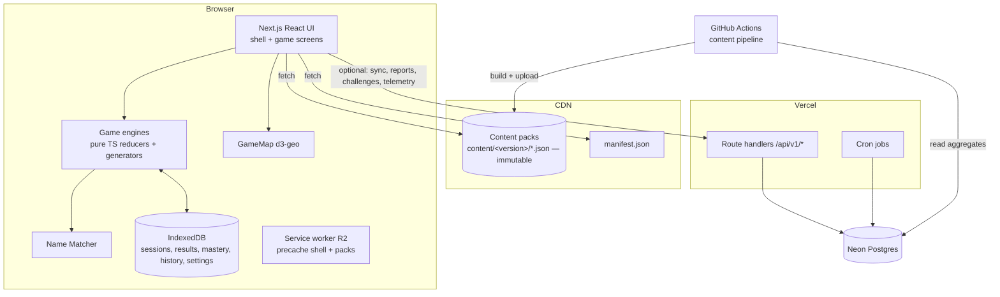
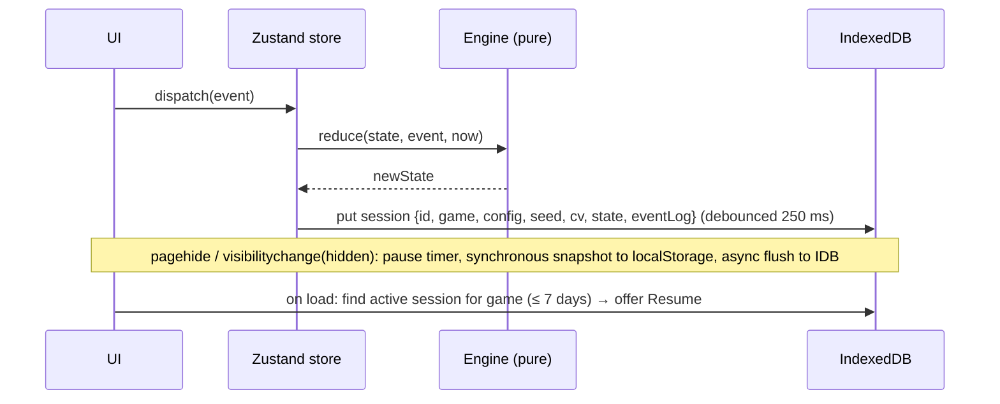

# Architecture

## 1. Starting point

The repository `rapha1232/geo-game` was **empty** when this blueprint was written: no commits, code, instructions or configuration. There are no existing decisions to respect, so this document makes all foundational choices and records each as an ADR (§15). The only pre-existing convention, set by the owner, is that **`main` is the single source of truth** and PRs are auto-merged ([AGENT_HANDOFF.md](AGENT_HANDOFF.md#git-workflow)).

## 2. Architectural drivers

| Driver | Consequence |
|---|---|
| Unlimited, instant replay | Puzzle generation runs **client-side** from cached content packs, with no network per round |
| Guest-first and offline-tolerant | Local-first persistence (IndexedDB). The server is optional for core play. |
| Reproducible challenges | A seeded PRNG plus versioned, immutable content packs |
| Map-heavy UI with accessibility | A custom map component over d3-geo (full control of hit testing, patterns and keyboard navigation) |
| Small team or a coding agent | One language (TypeScript), one repository, managed hosting, few moving parts |
| Data quality | A deterministic content pipeline with a validator and git-based editorial overrides |

## 3. Recommended stack

| Layer | Choice | Why |
|---|---|---|
| Language | **TypeScript** (strict), Node 22 LTS | One language from pipeline to UI. Shared schemas. |
| Monorepo | **pnpm** workspaces + **Turborepo** | Fast installs, task caching, clear package boundaries |
| Web framework | **Next.js 15** (App Router) + **React 19** | Static generation for catalog and info pages, route handlers for a small API, first-class Vercel deploys |
| UI primitives | **React Aria Components** | Accessible combobox, listbox, dialog and drag-and-drop reorder with keyboard support built in |
| Styling | CSS Modules + CSS custom-property tokens ([UX_AND_DESIGN §5](UX_AND_DESIGN.md#5-visual-system)) | Full control of the design system. No runtime CSS-in-JS cost. |
| Client state | Pure TS game reducers + **Zustand** stores | Engines are framework-free and unit-testable. Zustand is a thin bridge to React. |
| Local persistence | **IndexedDB** via **Dexie** | Structured, sizable and async. Holds sessions, results, mastery and history. |
| Server state (R2) | **TanStack Query** | Sync status, caching and retries |
| Map | **d3-geo**, **d3-zoom**, **topojson-client**, **flatbush** (spatial index), **polylabel** | Projection control (Equal Earth, azimuthal equal-area), small bundle, no tile server |
| Content pipeline | Node scripts + **mapshaper** (simplification) + **topojson-server** + **zod** | Deterministic builds from pinned sources |
| Database | **PostgreSQL 16** on **Neon** (serverless, preview branches) | Only for accounts, synced results, reports, challenges and telemetry |
| ORM / migrations | **Drizzle ORM** + drizzle-kit | Type-safe, SQL-first, light |
| Auth (R2) | **Auth.js v5** (email magic link via Resend + Google OAuth), database sessions | No passwords. Guest-first. |
| Validation | **zod** schemas in `packages/schemas` | One source for pack, API and DB-boundary validation |
| Hosting | **Vercel** (web + API + cron), **Vercel Blob** (content packs) | Previews per PR. Immutable versioned assets on a CDN. |
| Testing | **Vitest**, **fast-check**, **Playwright**, **@axe-core/playwright**, **Lighthouse CI** | [TESTING_AND_ACCEPTANCE.md](TESTING_AND_ACCEPTANCE.md) |
| CI | **GitHub Actions** | Lint, typecheck, test, content validation, preview deploy |
| Analytics | Cookieless aggregate analytics (Vercel Web Analytics) | Product metrics without personal tracking |
| Errors | Sentry (browser + server), PII scrubbing on | Crash visibility |

## 4. System overview and boundaries



| Responsibility | Client | Server |
|---|---|---|
| Puzzle generation, validation, scoring | ✅ (authoritative for personal play) | ❌ |
| Content | Reads packs | Serves static packs (CDN) |
| Guest progress | ✅ IndexedDB | ❌ |
| Account progress (R2) | Cache + sync queue | ✅ Postgres (source of truth for signed-in users) |
| Challenge short codes | Generates long codes locally | Stores short-code → long-code mappings |
| Reports | Submits | Stores, triages (admin) |
| Telemetry aggregates (R2) | Sends anonymous answer events | Aggregates nightly |

**Trust model:** with no public leaderboards, client-side scoring is acceptable. The server never ranks players. Results uploaded to an account are validated only for schema and plausibility (e.g. score ≤ max), not re-simulated. If competitive features are ever added, server-side verification by replaying the seed and event log becomes necessary. The event log is already recorded to make that possible ([DATA_MODEL §3](DATA_MODEL.md#3-database-schema-postgres)).

## 5. Shared game infrastructure vs game-specific logic

### 5.1 Repository layout

```
/
├─ apps/web/                      Next.js app (routes, pages, game screens, API route handlers)
├─ packages/
│  ├─ schemas/                    zod schemas: content packs, API payloads, results
│  ├─ game-kit/                   PRNG, seeds, Repeat Guard, timer model, session + result types, MicroRound contract, mastery
│  ├─ name-matcher/               norm(), alias index, exact/fuzzy/prefix-hold logic
│  ├─ geo/                        haversine, rhumb bearing, sectors, point-in-polygon, distance-to-polygon, polylabel wrapper, projections
│  ├─ ui/                         design tokens, components (AnswerInput, ChoiceGrid, OrderList, TimerBadge, ResultSummary, EntityCard), GameMap
│  └─ games/
│     ├─ quiz/                    engine + generator (no React)
│     ├─ silhouette/
│     ├─ fact-pin/
│     └─ …                        (R2+: deep-cut, border-run, rank-it, atlas; R3: chronology, lost-borders, knowledge-run)
├─ tools/content-pipeline/        fetch, normalize, merge, overrides, derive, validate, build, release
├─ content/                       editorial YAML: overrides, facts, sets, disputes, style, achievements, daily config
├─ data/sources.lock.yaml         pinned source versions + checksums
└─ docs/                          this blueprint
```

**Dependency rule:** `games/*` depend only on `game-kit`, `name-matcher`, `geo` and `schemas`. They never depend on React or `apps/web`. `ui` depends on `geo` and `schemas`. `apps/web` composes everything. ESLint boundary rules enforce this.

### 5.2 Engine pattern

Every game engine exports pure functions:

```ts
// Contract example (illustrative signatures, not implementation)
type Engine<Config, State, Event, Result> = {
  generate(config: Config, seed: Seed, ctx: GenContext): State;        // deterministic
  reduce(state: State, event: Event, now: MonoTime): State;            // pure
  isTerminal(state: State): boolean;
  result(state: State): Result;                                        // scoring
  serialize(state: State): JsonValue; deserialize(json: JsonValue): State;
};
type GenContext = { packs: LoadedPacks; history: RepeatHistory; mastery?: MasterySnapshot; contentVersion: string };
```

A React screen subscribes to a Zustand store wrapping `reduce`. Every dispatched event is (a) applied, (b) appended to the session's event log, and (c) persisted (§9).

### 5.3 Game module contract

Each game registers a `GameModule` in `apps/web/games/registry.ts`:

| Member | Purpose |
|---|---|
| `id`, `slug`, `phase`, `title`, `pitch`, `tags` | Catalog and search |
| `requiredPacks(config)` | Which packs to load (so the loader can prefetch) |
| `configSchema` (zod) + `defaultConfig` | Configuration and challenge-code encoding |
| `engine` | §5.2 |
| `Screen` (lazy React component) | The play UI |
| `ResultView` | Fills the slots of the shared `ResultSummary` |
| `microRound?` | `(seed, difficulty) => MicroRoundState` for Knowledge Run (R3) |
| `masterySkills` | Which skills results update (`recall`, `locate`, `flag`, `capital`, `shape`, …) |
| `dailySchedulePack?` | Name of the schedule pack if the game supports Daily |

## 6. Map rendering, geometry, projections and asset delivery

### 6.1 Geometry packs

| Pack | Source | Simplification | Format | Size budget (gzip) | Loaded when |
|---|---|---|---|---|---|
| `geo.world.110m` | NE 1:110m admin-0 map units + tiny-entity points | none beyond NE | TopoJSON, quantized 1e5 | ≤ 110 KB (measured 102 KB with the real data at 1e5 quantization; 90 KB was an estimate) | Any world map at zoom < 3 |
| `geo.world.50m` | NE 1:50m | none | TopoJSON 1e5 | ≤ 450 KB | Zoom ≥ 3, or continent-scope maps (tiles by continent: ≤ 120 KB each) |
| `geo.world.10m` | NE 1:10m | mapshaper Visvalingam to 12% | TopoJSON 1e6, **split by continent** | ≤ 250 KB per continent | Zoom ≥ 7. Fact Pin scoring (point-in-polygon). |
| `geo.silhouettes` | From 10m main groups (§silhouette 5.4) | 15% | Per-entity TopoJSON objects, bundled by continent | ≤ 80 KB per continent | Silhouette |
| `geo.admin1.<ISO>` (R2) | NE admin-1 or geoBoundaries gbOpen | 10–20% | TopoJSON per country | ≤ 150 KB each | Subdivision quizzes |
| `history.basemaps.<year>` (R3) | historical-basemaps | 15% | TopoJSON per slice | ≤ 200 KB each | Lost Borders |

All geometry is WGS84 lon/lat. The pipeline fixes winding order, removes slivers under 0.5 km², and validates antimeridian handling (features crossing ±180° are kept as single features with longitudes beyond 180 converted to d3's spherical representation, and tested in AC-FP-008 and AC-SH-003).

### 6.2 Projections

| Use | Projection | Notes |
|---|---|---|
| World maps (quiz, Fact Pin, Atlas) | **Equal Earth** (`d3.geoEqualEarth`) | Equal-area, so sizes are honest, and it looks good |
| Continent and regional maps | Lambert azimuthal equal-area centered on the region, or conic equal-area for mid-latitudes | Defined per scope in `content/map-views.yaml` |
| Silhouette | Azimuthal equal-area centered on the shape | [silhouette §5.4](games/silhouette.md#54-silhouette-geometry-rules-islands-overseas-territories-multipart-shapes) |
| Atlas globe (R3) | Orthographic | Optional view |

Mercator is not used, because it distorts size and polar regions.

### 6.3 Rendering approach

- **SVG** for interactive feature layers (≤ about 3,000 paths on screen). Each feature is a `<path>` with `data-id`, and patterns are applied via `fill="url(#hatch-45)"`. SVG gives crisp patterns, focus outlines and simple accessibility hooks.
- **Canvas 2D** underlay for dense, non-interactive layers (10m coastlines when zoomed in, graticule, historical blur).
- **Zoom/pan:** d3-zoom transforms a `<g>`. During gestures, path redraws use CSS transforms. When the gesture ends, the renderer switches level of detail (110m → 50m → 10m) and recomputes tiny-target rings.
- **Hit testing:** pointer events on SVG paths, plus a tiny-target overlay layer of `<circle>`s on top ([quiz-library §5.4](games/quiz-library.md#54-map-interaction-rules-map_click-and-type_prompted-with-highlight)). Free-pin mode converts screen → lon/lat with `projection.invert`.
- **Keyboard spatial navigation:** a `flatbush` index of label points (projected). Arrow keys pick the nearest feature whose bearing from the current one is within ±60° of the arrow direction.
- **Labels:** an optional label layer with collision avoidance (greedy, by priority = population rank), hidden in quiz modes.

### 6.4 Asset delivery

- Packs live at `https://<blob-host>/content/<version>/<pack>.<contenthash>.json` with `Cache-Control: public, max-age=31536000, immutable`.
- `manifest.json` (`max-age=300, stale-while-revalidate=86400`) lists the current version and the pack URLs for every **retained** version (180 days).
- The client loads the manifest on app start, prefetches `core.countries` and `geo.world.110m` when idle, and loads other packs on demand.
- The service worker (R2) precaches the shell, the R1 packs of the current version, and fonts.

## 7. Content pipeline (technical)

Steps and rules are in [DATA_AND_CONTENT §3](DATA_AND_CONTENT.md#3-content-pipeline) and §10. Technically:
- `pnpm content:fetch [--update-lock] [--wikidata]` downloads and pins the sources. `pnpm content:build [--version V] [--out DIR]` runs the steps. Outputs go to `dist/content/<version>/` (`content/version.txt` holds the default version). Building twice gives byte-identical packs, which the test suite checks on fixtures and, when `data/raw` is present, on all 197 countries.
- `pnpm content:validate` runs the validators only (fast, for editor PRs).
- CI (`content.yml`) runs on changes to `content/**`, `tools/content-pipeline/**` or `data/sources.lock.yaml`: build → validate → determinism check (build twice, compare hashes) → upload to Blob under a **preview version** (`pr-<n>`). On merge to `main`: release `YYYY.MM.N`, upload, and update `manifest.json`.

## 8. Puzzle generation, reproducibility and difficulty

### 8.1 Seeds and PRNG

- **Seed:** 10 characters of Crockford base32 (50 bits), e.g. `K7Q2M9XD1A`. Generated with `crypto.getRandomValues`.
- **PRNG:** `sfc32`, initialized from `cyrb128(seed + "|" + gameId + "|" + stableConfigHash)`. This is deterministic across browsers (32-bit integer math only, with no `Math.random` and no floating-point-dependent branching in selection).
- **Sub-streams:** `rng.fork("items")`, `rng.fork("distractors")`, … derive independent streams by hashing the label into the state, so adding a new random choice later doesn't shift existing streams.
- **Normative details:** cyrb128 is the standard 4×32-bit variant over UTF-16 code units. sfc32 runs 15 warm-up rounds before the first output. A fork's key is `<parent key>/<label>` (the parent's *key*, not its current state), so a fork never depends on how many values the parent has drawn. `configHash` is the first cyrb128 word as 8 lowercase hex characters. Golden vectors: `packages/game-kit/test/prng.golden.json`, cross-checked against an independent Python implementation.
- **Stable config hash:** canonical JSON (sorted keys) of the config → `cyrb128` → hex.
- **Shuffles:** Fisher–Yates using the stream's `nextUint32() % n`, with rejection sampling to avoid modulo bias.

### 8.2 Repeat Guard

A shared utility with per-game rules:

```ts
type RepeatRules = {
  windowSize: number | ((poolSize: number) => number);   // exclude last N targets
  extraWindows?: { predicate: (id) => boolean; size: number }[]; // e.g. small countries: 7
  downWeight?: { predicate: (id, prev) => boolean; factor: number }[]; // e.g. same continent ×0.3
  relax: "halve-window" | "reset-oldest-half";
};
```

- History is a ring buffer of up to 500 target IDs per `(gameId, poolKey)` in IndexedDB (synced in R2).
- Seeded challenges and dailies **ignore** personal history (so they are identical for everyone) but apply the rules *within* the generated sequence.
- Selection never fails. If the eligible set is empty, the rules are relaxed according to `relax`, and the relaxation is logged in the session (`guardRelaxed: true`).

### 8.3 Difficulty calibration

- The priors ([DATA_AND_CONTENT §9](DATA_AND_CONTENT.md#9-difficulty-priors)) ship in packs.
- R2: an anonymous telemetry event per answered item `{gameId, itemKind, entityId|factId|promptId, correct, attempt, difficultySetting, contentVersion}` → aggregated nightly into `calibration_stats` → the pipeline produces the next patch pack with posteriors and Deep Cut pick rates.
- Difficulty is used **only for generation weighting**. Scores never depend on calibration, except Deep Cut tiers, which are stored per result.

### 8.4 Challenge codes

- **Long code (always available, offline):** `base64url(deflateRaw(canonicalJSON({v:1, g, c, s, cv, sc?})))`, where `g` = game ID, `c` = config with short keys, `s` = seed, `cv` = content version, and `sc` = optional sender score. The URL is `/c/<code>`, typically 90–130 characters for a Silhouette challenge (the config, seed, version and sender score all travel in it).
- **Short code (R1, needs the server):** `POST /api/v1/challenges` stores the long payload and returns `<PREFIX>-XXXX-XXXX` (e.g. `SH-4KQ2-M9XD`, 8 Crockford base32 characters = 40 bits). `/c/SH-4KQ2-M9XD` resolves server-side and redirects. The share UI uses the short code when online and falls back to the long code.
- **Version handling:** if `cv` is retained (≤ 180 days old), the challenge loads that version's packs, so the puzzle is identical. If it has expired, the page explains that "This challenge used an older version of our data" and offers the same config with the same seed on the current version (labelled "approximately the same").
- **Decoder hardening:** max code length 2 KB, decompressed max 8 KB, zod-validated config. Unknown `v` → friendly error.

### 8.5 Daily schedules

Dailies are precomputed schedules in packs (`daily/<game>.json`: date → target IDs). They are keyed by the **player's local date** (`Intl.DateTimeFormat().resolvedOptions().timeZone`). Spoilers are possible by reading the pack; this is accepted, since there are no competitive stakes ([OPEN_QUESTIONS_AND_RISKS R-08](OPEN_QUESTIONS_AND_RISKS.md#risks)).

## 9. State management, session persistence and result storage

### 9.1 Session lifecycle



- **Timer model:** `{ elapsedMs, runningSince: number | null }` using `performance.now()`. Pause sets `elapsedMs += now − runningSince` and `runningSince = null`. Timers pause on `visibilitychange: hidden`, `pagehide`, the Pause action and the resume prompt. They never use wall-clock time.
- **Snapshots:** IndexedDB writes are async and may not finish during `pagehide`, so a compact snapshot (≤ 50 KB) is also written synchronously to `localStorage["meridian:session:<game>"]`. On restore, the newer of the IDB and localStorage snapshots (by `seq`) wins.
- **One active session per game.** A second tab with the same game takes ownership via a `BroadcastChannel("meridian-sessions")` message, and the older tab shows "continued in another tab".
- **Resumed sessions** set `result.flags.resumed = true` and `pauseCount`.

### 9.2 Results

- A `GameResult` is written at the terminal state: ULID ID, game, mode, config, seed, content version, score fields, per-item outcomes, started/ended times, duration, flags. Schema: [DATA_MODEL §2.9](DATA_MODEL.md#29-game-result-client-and-server).
- **Mastery and history** are updated in the same IndexedDB transaction.
- **Sync (R2):** results go into a `syncQueue`. `POST /api/v1/results:batch` (≤ 50 per call) is idempotent by result ID. Retries use exponential backoff (2 s → 5 min, with jitter).
- **Retention (local):** the last 2,000 results are kept with full items. Older results are compacted to summary-only.

## 10. Background jobs

| Job | Schedule | Phase | Action |
|---|---|---|---|
| `aggregate-telemetry` | Nightly 02:17 UTC (Vercel Cron) | R2 | Roll raw `answer_events` into `calibration_stats`. Delete raw events older than 90 days. |
| `content-calibration-release` | Nightly 03:23 UTC (GitHub Actions schedule) | R2 | Pipeline reads `calibration_stats` (read-only role) and builds a patch release if the changes are significant (any tier change or a difficulty shift > 0.05) |
| `report-dedupe` | Hourly | R1 | Group duplicate reports |
| `fact-review-due` | Weekly | R1 | Open a GitHub issue listing facts within 30 days of `review_due` |
| `daily-schedule-extend` | Monthly | R1 | Ensure ≥ 365 days of schedule (an automated content PR) |
| `expire-challenges` | Weekly | R1 | Remove short codes unused for more than 2 years |
| `retro-rulings` | On ruling | R3 | Apply Deep Cut ruling credits to stored account results |

## 11. Testing and deployment (summary)

The full strategy is in [TESTING_AND_ACCEPTANCE.md](TESTING_AND_ACCEPTANCE.md).

- **Environments:** `preview` (every PR: Vercel preview + Neon branch + preview content version), `production` (`main`).
- **Pipeline (`ci.yml`):** install → lint (ESLint, Prettier check) → typecheck → unit and property tests → content validate (when content changed) → build → Playwright E2E against the preview → axe → Lighthouse CI budgets. All of these are required checks for auto-merge.
- **Database migrations:** drizzle-kit migrations are committed and applied automatically on deploy to `main` (before traffic shifts), and to Neon branches on preview. Migrations must be backward-compatible with the previous deploy (expand → migrate → contract).
- **Rollback:** Vercel instant rollback for the app. The content manifest can be pointed back to the previous version (`content:rollback <version>` workflow).

## 12. Security and privacy

| Area | Requirement |
|---|---|
| Transport | HTTPS only, HSTS (`max-age=63072000; includeSubDomains; preload`) |
| CSP | `default-src 'self'; script-src 'self' 'nonce-…' 'strict-dynamic'; style-src 'self' 'nonce-…'; style-src-attr 'unsafe-inline'; img-src 'self' data: <blob-host>; connect-src 'self' <blob-host> <analytics>; frame-ancestors 'none'; object-src 'none'; base-uri 'self'; form-action 'self'`. React Aria injects one small `<style>` and reads the nonce from `<meta name="csp-nonce">`, and components set inline `style` attributes, hence the nonce and `style-src-attr`. A per-request nonce makes pages render on demand instead of being prerendered, which is a deliberate cost of AC-PL-025 |
| Input validation | zod on every API input. Size limits: JSON body ≤ 64 KB (results batch ≤ 512 KB). |
| Rate limiting | Vercel WAF rules: `/api/v1/reports` 10/min/IP, `/api/v1/challenges` 30/min/IP, telemetry 120/min/IP, auth endpoints 10/min/IP. 429s include `Retry-After`. |
| Auth (R2) | Auth.js database sessions, cookies `HttpOnly; Secure; SameSite=Lax`, CSRF protection on mutations, magic links single-use with a 15-minute expiry |
| Authorization | User data is scoped by `user_id` in every query (a repository-layer helper). Admin routes (R3) require `role ∈ {editor, senior_editor, maintainer}`. |
| Abuse | Report text is stored and rendered as plain text, never as HTML. Basic profanity and spam heuristics flag reports for review. |
| Privacy: guests | No cookies. No personal data leaves the device except optional reports (with an optional email) and anonymous telemetry (R2; random per-session ID, no IP storage, opt-out in Settings). |
| Privacy: accounts | Store email, optional display name and game data only. Self-service export (JSON) and deletion (hard-delete within 24 h, backups expire in 30 days). |
| Retention | Raw telemetry 90 days. Reports 2 years. Challenge short codes 2 years after last use. |
| Secrets | Vercel environment variables only. Never in the repository. Rotated on staff change. |
| Dependencies | Renovate weekly, `pnpm audit` in CI (high severity blocks), lockfile committed |
| Legal pages | `/about/privacy` and `/about/sources` (license attributions) are required for R1 |

## 13. Performance targets

| Metric | Target | Measured by |
|---|---|---|
| LCP (p75, mobile, 4G) | ≤ 2.5 s on Home and the game hubs | Lighthouse CI (Moto G Power profile) + field analytics |
| INP (p75) | ≤ 200 ms | Field analytics |
| CLS | ≤ 0.1 | Lighthouse CI |
| Initial JS (shell route) | ≤ 170 KB gzip | Bundle analyzer budget in CI |
| Per-game chunk | ≤ 120 KB gzip (excluding packs) | CI budget |
| Name Matcher keystroke (exact) | ≤ 2 ms p95 for a 300-entity universe with about 3,000 aliases | Vitest bench |
| Fuzzy match on submit | ≤ 20 ms p95 | Vitest bench |
| Next-round generation | ≤ 50 ms typical, ≤ 300 ms max (packs cached) | Playwright timing (AC-SH-019) |
| Map pan/zoom | ≥ 55 fps desktop, ≥ 40 fps mid-tier Android with the 50m world | Playwright trace on CI hardware (indicative) + manual device check |
| Fact Pin point-in-polygon + distance | ≤ 30 ms per confirm | Vitest bench |

## 14. Observability

- Sentry for errors, with the release tagged by git SHA and content version.
- API logs: structured JSON (request ID, route, status, latency). No PII.
- Health endpoint `GET /api/v1/health` → `{status, db, contentVersion}`.
- Uptime check on `/` and `/api/v1/health` every 5 minutes.

## 15. Architecture decision records (summary)

| ADR | Decision | Alternatives considered | Rationale |
|---|---|---|---|
| ADR-001 | TypeScript monorepo (pnpm + Turborepo) | Separate repos; Python backend | One language. Shared schemas. A single agent can work across it. |
| ADR-002 | Client-side generation from static packs | Server-generated puzzles | Instant unlimited play, offline, low cost. No competitive stakes need server authority. |
| ADR-003 | Custom d3-geo SVG/Canvas map | MapLibre GL + vector tiles; Leaflet | No tile server. Full control of patterns, hit areas, projections (equal-area, azimuthal) and accessibility. World-scale data is small. MapLibre can be reconsidered for a deep-zoom Atlas in R3+. |
| ADR-004 | Postgres only for user, report and telemetry data. Content stays in git and packs. | Content in a DB/CMS | Reviewable diffs, deterministic builds, rollbacks via manifest |
| ADR-005 | Next.js on Vercel + Neon + Vercel Blob | Self-hosted; Cloudflare | Managed, preview environments per PR, minimal ops |
| ADR-006 | Equal Earth for world maps | Robinson, Mercator | Equal-area, attractive, standard in d3 |
| ADR-007 | Ref point = pole of inaccessibility of the largest polygon | Centroid; bbox center | Always inside land. Intuitive for multipart countries ([silhouette §5.3](games/silhouette.md#53-distance-direction-proximity-normative-definitions)). |
| ADR-008 | Rhumb-line bearing for direction | Initial great-circle bearing | Never routes over poles. Matches flat-map intuition. |
| ADR-009 | Guest-first local persistence with optional sync | Mandatory accounts | Product principle 1 |
| ADR-010 | Long, self-contained challenge codes plus optional short codes | Server-only codes | Links work offline and survive server issues |
