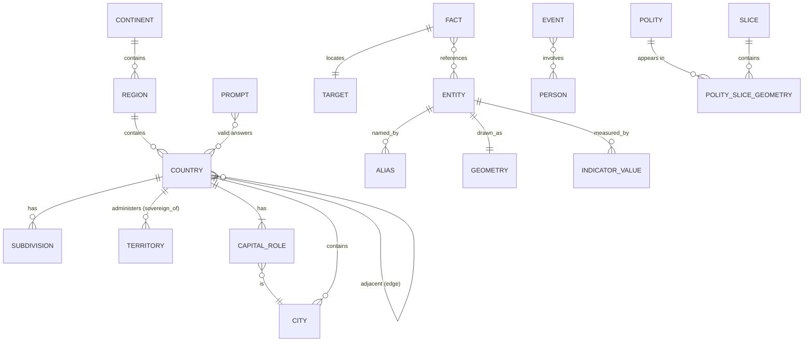
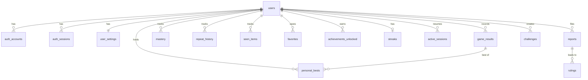

# Data Model

There are two kinds of data:

1. **Content** (geography, facts, prompts, events): built by the pipeline into immutable, versioned JSON **packs**. No database is involved. See [DATA_AND_CONTENT.md](DATA_AND_CONTENT.md).
2. **User and operational data** (results, progress, reports, challenges, telemetry): stored in **IndexedDB** on the device (guests) and **Postgres** (accounts, reports, challenges, telemetry).

All schemas are defined once as zod schemas in `packages/schemas`. The tables below are normative for field names and constraints.

## Stable identifiers

| Entity type | Format | Example | Derivation |
|---|---|---|---|
| Country (sovereign-197) | `country:<ISO3166-1 alpha-3>` | `country:FRA`, `country:XKX` (Kosovo, user-assigned code), `country:TWN`, `country:PSE`, `country:VAT` | ISO alpha-3, or the de facto code where none exists |
| Territory | `territory:<alpha-3>` | `territory:GRL`, `territory:PRI`, `territory:HKG`, `territory:ESH` | ISO alpha-3 |
| Continent | `continent:<code>` | `continent:AF`, `AN`, `AS`, `EU`, `NA`, `OC`, `SA` | Fixed list |
| UN subregion | `region:<slug>` | `region:western-africa` | M49 name slug |
| Subdivision | `subdivision:<ISO 3166-2>` | `subdivision:US-CA`, `subdivision:GB-ENG` | ISO 3166-2 |
| City | `city:gn-<geonameid>` | `city:gn-2988507` (Paris) | GeoNames ID |
| Physical feature | `feature:<slug>` (+ `wd` external ID) | `feature:nile`, `feature:atacama` | Editorial slug |
| Place (point of interest) | `place:<slug>` | `place:south-pole` | Editorial slug |
| Fact | `fact:<4+ digits>` | `fact:0142` | Sequential, never reused |
| Deep Cut prompt | `prompt:<family>-<slug>` | `prompt:lang-portuguese` | Generated deterministically from the template + parameter |
| Event | `event:<slug>` | `event:printing-press-gutenberg` | Editorial |
| Person | `person:<slug>` | `person:johannes-gutenberg` | Editorial |
| Polity (historical) | `polity:<slug>` | `polity:ottoman-empire` | Editorial |
| Historical slice | `slice:<astronomical year>` | `slice:1700`, `slice:-323` | Source slice year |
| Achievement | `ACH-<GAME>-<NAME>` | `ACH-SH-50` | Editorial |

**Rules:**
- IDs are **never reused**. Retired IDs are appended to `content/retired-ids.txt` (validator `ID_REUSED`).
- If an ISO code changes (as when a country is renamed), the ID **does not change**, and the new code is added as an external ID. Example: if a country's alpha-3 changed, `country:OLD` stays and `external_ids.iso3` is updated.
- Every entity has an `external_ids` map: `{iso2, iso3, iso_numeric, m49, wikidata, geonames, ne_adm0_a3, gb_shapeID}` where applicable.

## 1. Relationships (content)



## 2. Content pack schemas

### 2.1 Manifest (`manifest.json`)

```json
{
  "current": "2026.11.0",
  "versions": {
    "2026.11.0": {
      "released_at": "2026-11-02T10:00:00Z",
      "packs": {
        "core.countries": {"url": "content/2026.11.0/core.countries.3f9a1c.json", "bytes": 61234, "sha256": "…"},
        "geo.world.110m": {"url": "content/2026.11.0/geo.world.110m.a81b22.json", "bytes": 88001, "sha256": "…"}
      },
      "licenses": ["ne:PD", "wd:CC0", "fi:MIT", "wb:CC-BY-4.0"],
      "notes_url": "content/2026.11.0/RELEASE_NOTES.md"
    }
  }
}
```

### 2.2 Entity records

Common fields (all geographic entity types):

| Field | Type | Required | Constraint |
|---|---|---|---|
| `id` | string | ✅ | Stable ID format |
| `type` | enum `country, territory, continent, region, subdivision, city, feature, place` | ✅ | |
| `names.canonical` | string | ✅ | Non-empty |
| `names.aliases[]` | `{text, kind, lang?, script?}` | ✅ (may be empty) | `kind` ∈ [DATA_AND_CONTENT §5.1](DATA_AND_CONTENT.md#51-alias-kinds) |
| `external_ids` | object | ✅ | — |
| `label_point` | `[lat, lon]` | ✅ | Inside the geometry (polygons) |
| `ref_point` | `[lat, lon]` | countries & territories | Inside the largest polygon |
| `bbox` | `[minLon, minLat, maxLon, maxLat]` | ✅ | |
| `parent_ids[]` | string[] | ✅ | e.g. `["region:western-europe", "continent:EU"]` |
| `sets[]` | string[] | countries & territories | `sovereign-197`, `un-193`, `territories` |
| `not_in_set_reason` | string | optional | Shown when typed in quizzes where it doesn't count |
| `sovereign_of` | string | territories | e.g. `country:DNK` for Greenland |
| `valid_from`, `valid_to` | ISO date | optional | |
| `difficulty` | `{recall, locate, flag, capital, shape}` 0–1 | countries & territories | |
| `source_ids[]` | string[] | ✅ | Registry IDs |

Country-specific fields: `continent`, `subregion`, `capitals[] {city, name, role, valid_from?, note?}`, `flag {svg, aspect, confusables[]}`, `population {value, year, source}`, `area_km2 {value, source}`, `languages_official[]` (R2), `driving_side` (R2), `currency` (R2).

### 2.3 Geometry objects

TopoJSON `Topology` per pack. Each geometry has `id` = entity ID and `properties: {parts?: "main"|"remote"}`. Silhouette packs contain only main-group parts, plus a `remote` object per entity.

### 2.4 Ambiguity groups (`core.ambiguity`)

| Field | Type | Example |
|---|---|---|
| `group` | string | `congo` |
| `alias` | string | `Congo` |
| `universe` | string | `country` |
| `members[]` | IDs | `["country:COG","country:COD"]` |
| `message` | string | "Which Congo? Try \"Republic of the Congo\" or \"DR Congo\"." |

Initial groups in the country/territory universe: **Congo** (COG, COD), **Korea** (PRK, KOR), **Virgin Islands** (`territory:VGB`, `territory:VIR`).

Considered and deliberately **not** grouped:

| Name | Why there's no group |
|---|---|
| Guinea | Exact canonical name of `country:GIN`. Prefix-hold covers Guinea-Bissau. |
| Dominica | Exact canonical name. Prefix-hold covers Dominican Republic. |
| Samoa | Exact name of `country:WSM`. "American Samoa" is a different key. |
| Georgia | Country and US state live in different answer universes |
| Macedonia | `former` alias of North Macedonia. The Greek region isn't in the country universe. |

### 2.5 Adjacency and crossings

```json
{"a": "country:ESP", "b": "country:FRA", "length_km": 656, "disputed": false}
{"a": "country:FRA", "b": "country:BRA", "length_km": 730, "via": "French Guiana", "disputed": false}
{"a": "country:GBR", "b": "country:FRA", "type": "tunnel", "name": "Channel Tunnel", "crossing": true}
```

Constraints: `a < b` lexicographically (canonical order), no self-edges, unique `(a, b, crossing)`.

### 2.6 Indicators

| Field | Type | Constraint |
|---|---|---|
| `indicator_id` | enum | `population, area, density, gdp_pc, life_exp, urban_pct, forest_pct, max_elev, capital_lat` |
| `entity_id` | ID | |
| `value` | number | Finite |
| `year` | int | 1960–current |
| `source_id` | string | Registry |

### 2.7 Facts, prompts, events, polities

Schemas are specified with examples in the game specs: facts [fact-pin §4.1](games/fact-pin.md#41-fact-record), prompts [deep-cut §4.3](games/deep-cut.md#43-prompt-record), events [chronology §4.1](games/chronology.md#41-event-record), polities [lost-borders §4](games/lost-borders.md#4-data-requirements). Common editorial fields: `status ∈ {draft, published, suspended, retired}`, `sources[] {title, url, license}`, `reviewed_at`, `review_due?`, `sensitive?: bool` (requires senior-editor approval).

### 2.8 Daily schedules

```json
{"game": "silhouette", "from": "2026-11-01", "to": "2028-10-31",
 "days": {"2026-11-01": ["country:MNG"], "2026-11-02": ["country:URY"]}}
```

Fact Pin days contain 5 fact IDs. Deep Cut days contain 5 prompt IDs. Border Run days contain `[A, B]`.

### 2.9 Game result (client and server)

| Field | Type | Constraint |
|---|---|---|
| `id` | ULID string | Client-generated, globally unique |
| `game_id` | enum | `quiz, silhouette, fact-pin, deep-cut, border-run, rank-it, chronology, lost-borders, knowledge-run` |
| `mode` | enum | `timed, untimed, learn, practice, practice-misses, unlimited, daily, seeded, run, endless` |
| `config` | object | Validated by the game's `configSchema` |
| `config_hash` | string | Stable hash |
| `pb_key` | string? | Quiz Library ([quiz-library §6.1](games/quiz-library.md#61-score)) |
| `seed` | string | 10-character Crockford base32 |
| `daily_date` | date? | For dailies |
| `challenge_code` | string? | When played from a link |
| `content_version` | string | `YYYY.MM.N` |
| `score`, `max_score` | number | `0 ≤ score ≤ max_score` |
| `outcome` | enum | `completed, solved, failed, gave_up, timeout, lives_out` |
| `items[]` | `{item_id, entity_id?, input?, status, attempts, hints, points, ms}` | ≤ 500 items |
| `meta` | object | Game-specific (e.g. Deep Cut tiers at time of play, Silhouette guesses with distances) |
| `flags` | `{resumed, pauseCount, assisted, guardRelaxed, attempt}` | `attempt` ≥ 1 for seeded/daily |
| `started_at`, `ended_at` | ISO datetime | `ended_at ≥ started_at` |
| `active_ms` | int | ≥ 0 |
| `event_log` | compact array | Optional on the server (kept for future verification) |

Example (Silhouette):

```json
{
  "id": "01JC8Z5V6R2Q8T3X9K4M7N1P0A",
  "game_id": "silhouette", "mode": "unlimited",
  "config": {"pool": "sovereign-197", "difficulty": "normal", "followUps": ["capital","flag"]},
  "config_hash": "9c1e2a7b", "seed": "K7Q2M9XD1A", "content_version": "2026.11.0",
  "score": 4, "max_score": 8, "outcome": "solved",
  "items": [{"item_id": "target", "entity_id": "country:FRA", "status": "correct", "attempts": 3, "hints": 1, "points": 3, "ms": 41210},
            {"item_id": "followup:capital", "status": "correct", "points": 1},
            {"item_id": "followup:flag", "status": "wrong", "points": 0}],
  "meta": {"guesses": [{"entity_id":"country:BRA","km":8651,"sector":"NE","proximity":56,"border":true},
                       {"entity_id":"country:ESP","km":865,"sector":"NE","proximity":95,"border":true},
                       {"entity_id":"country:FRA","km":0,"proximity":100}]},
  "flags": {"resumed": false, "pauseCount": 0, "assisted": false, "guardRelaxed": false, "attempt": 1},
  "started_at": "2026-11-05T08:01:02Z", "ended_at": "2026-11-05T08:01:52Z", "active_ms": 49800
}
```

(`max_score` for Silhouette = 6 for the main round + 1 per follow-up.)

### 2.10 Local IndexedDB stores (Dexie)

| Store | Key | Indexes | Contents |
|---|---|---|---|
| `sessions` | `game_id` | `updated_at` | Active session per game (state, event log, seq) |
| `results` | `id` | `game_id, ended_at, pb_key, daily_date` | GameResult |
| `pbs` | `pb_key` | — | `{pb_key, result_id, score, active_ms}` |
| `mastery` | `[entity_id+skill]` | `due_at` | `{mastery, exposures, last_seen_at, due_at}` |
| `history` | `[game_id+pool_key]` | — | Ring buffer of target IDs (≤ 500) |
| `seen` | `[kind+id]` | — | Fact Pin seen facts, Atlas discovered entities |
| `favorites` | `item_key` | — | `game:silhouette`, `quiz:countries-of-the-world` |
| `achievements` | `id` | — | Unlock records (R2) |
| `settings` | `'settings'` | — | Settings object |
| `syncQueue` | `id` | `created_at` | Pending uploads (R2) |
| `packs` | `url` | — | Cached pack JSON (R1 without a service worker) |

Schema versioning: the Dexie `version(n).upgrade()` migrations are tested with fixture databases from each previous version.

## 3. Database schema (Postgres)

All timestamps are `timestamptz`. IDs are `uuid` (v7) unless noted.

### 3.1 Identity (R2)

| Table | Columns | Constraints / indexes |
|---|---|---|
| `users` | `id`, `email citext`, `email_verified timestamptz`, `display_name text null`, `role text default 'player'`, `created_at`, `deleted_at null` | `UNIQUE(email) WHERE deleted_at IS NULL`. `role ∈ {player, editor, senior_editor, maintainer}`. |
| `auth_accounts` | Auth.js adapter columns (`user_id`, `provider`, `provider_account_id`, tokens…) | `UNIQUE(provider, provider_account_id)`, FK `users` ON DELETE CASCADE |
| `auth_sessions` | `session_token`, `user_id`, `expires` | PK `session_token`. FK cascade. |
| `auth_verification_tokens` | `identifier`, `token`, `expires` | PK (`identifier`, `token`) |
| `user_settings` | `user_id PK`, `settings jsonb`, `updated_at` | FK cascade. Settings validated by zod before write. |

### 3.2 Progress (R2)

| Table | Columns | Constraints / indexes |
|---|---|---|
| `game_results` | `id text PK` (ULID), `user_id`, `game_id text`, `mode text`, `config jsonb`, `config_hash text`, `pb_key text null`, `seed text`, `daily_date date null`, `challenge_code text null`, `content_version text`, `score numeric`, `max_score numeric`, `outcome text`, `items jsonb`, `meta jsonb`, `flags jsonb`, `event_log jsonb null`, `started_at`, `ended_at`, `active_ms int`, `created_at default now()` | `CHECK (score >= 0 AND score <= max_score)`, `CHECK (ended_at >= started_at)`, `CHECK (active_ms >= 0)`. Index `(user_id, ended_at DESC)`, `(user_id, game_id, ended_at DESC)`, partial unique `(user_id, game_id, daily_date) WHERE mode='daily' AND (flags->>'attempt')::int = 1`. FK cascade. |
| `personal_bests` | `user_id`, `pb_key`, `game_id`, `result_id`, `score`, `active_ms`, `updated_at` | PK (`user_id`, `pb_key`). FK `result_id → game_results(id)`. |
| `mastery` | `user_id`, `entity_id text`, `skill text`, `mastery real`, `exposures int`, `last_seen_at`, `due_at` | PK (`user_id`, `entity_id`, `skill`). `CHECK (mastery BETWEEN 0 AND 1)`. Index (`user_id`, `due_at`). |
| `repeat_history` | `user_id`, `game_id`, `pool_key`, `target_ids text[]`, `updated_at` | PK (`user_id`, `game_id`, `pool_key`). `CHECK (cardinality(target_ids) <= 500)`. |
| `seen_items` | `user_id`, `kind text`, `item_id text`, `first_seen_at` | PK (`user_id`, `kind`, `item_id`) |
| `favorites` | `user_id`, `item_key text`, `created_at` | PK (`user_id`, `item_key`) |
| `achievements_unlocked` | `user_id`, `achievement_id text`, `unlocked_at`, `result_id null` | PK (`user_id`, `achievement_id`) |
| `streaks` | `user_id PK`, `enabled bool default false`, `current int`, `best int`, `last_active_date date`, `freezes_available smallint`, `freeze_period_start date` | `CHECK (freezes_available BETWEEN 0 AND 2)` |
| `active_sessions` | `user_id`, `game_id`, `session jsonb`, `seq int`, `updated_at` | PK (`user_id`, `game_id`). Only untimed modes are uploaded. |

**Merge semantics (first sign-in and multi-device):** results are a union by `id` (insert-or-ignore). `mastery` is last-writer-wins by `last_seen_at`. `repeat_history` is a union keeping order by recency, capped at 500. `favorites` is a union (deletes are tracked as tombstones for 30 days). `pbs` are recomputed server-side from results.

### 3.3 Platform (R1)

| Table | Columns | Constraints / indexes |
|---|---|---|
| `challenges` | `code text PK` (e.g. `SH-4KQ2M9XD` normalized without the dash), `game_id`, `payload text` (long code), `content_version`, `created_at`, `last_used_at`, `uses int default 0`, `creator_user_id null` | `CHECK (length(payload) <= 2048)`. Index `last_used_at`. |
| `reports` | `id`, `created_at`, `status text default 'new'`, `severity text null`, `category text`, `message text`, `context jsonb`, `target_ref text null`, `content_version text`, `reporter_email citext null`, `user_id null`, `duplicate_of uuid null`, `assigned_to uuid null`, `resolution_note text null`, `resolved_in_version text null`, `resolved_at null` | `status ∈ {new, triaged, accepted, declined, fixed, duplicate}`, `severity ∈ {S1,S2,S3}`, `category ∈ {answer_rejected, answer_accepted_wrongly, wrong_fact, map_issue, spelling, sensitive, other}`, `CHECK (length(message) BETWEEN 10 AND 1000)`. Index (`status`, `created_at`), (`target_ref`). |
| `content_releases` | `version text PK`, `released_at`, `manifest_sha256`, `notes text` | — |

### 3.4 Telemetry and calibration (R2)

| Table | Columns | Notes |
|---|---|---|
| `answer_events` | `id bigserial`, `occurred_at`, `session_hash text` (random per play session, never linked to a user), `game_id`, `item_kind`, `item_id`, `prompt_id null`, `answer_entity_id null`, `correct bool`, `attempt smallint`, `difficulty_setting text`, `content_version` | Range-partitioned by month. Raw rows deleted after 90 days. |
| `calibration_stats` | `item_kind`, `item_id`, `prompt_id text default ''`, `n int`, `correct_first int`, `pick_counts jsonb`, `updated_at` | PK (`item_kind`, `item_id`, `prompt_id`) |

### 3.5 Editorial (R3)

| Table | Columns |
|---|---|
| `rulings` | `id text PK` (`R-0001`), `report_id`, `target_ref`, `decision text` (`added_answer`, `removed_answer`, `corrected_fact`, `declined`), `rationale text`, `content_version`, `created_at`, `published bool` |
| `admin_audit_log` | `id`, `actor_user_id`, `action`, `target`, `diff jsonb`, `created_at` |

## 4. Database ER diagram



## 5. Deletion and retention

| Data | On account deletion | Otherwise retained |
|---|---|---|
| `users` and all user-owned rows | Hard-deleted within 24 h (cascade) | Until deletion |
| `reports` linked to a user | `user_id` and `reporter_email` set to NULL. Text kept. | 2 years |
| `challenges.creator_user_id` | Set to NULL | 2 years after last use |
| `answer_events` | Never linked to users | 90 days |
