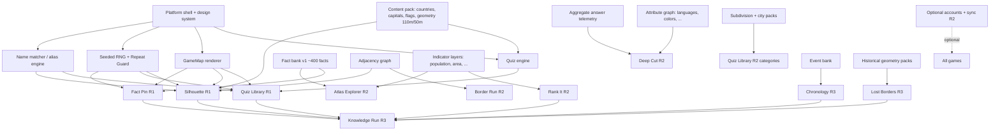

# Game Catalog

This catalog lists every planned game family with its evaluation, phase and dependencies. Detailed rules live in [`games/`](games/). Ideas that were evaluated and rejected are listed in §4, so they are not re-proposed later.

## 1. Catalog overview

| ID | Game | One-line pitch | Phase | Spec | Inspiration |
|---|---|---|---|---|---|
| G-QZ | **Quiz Library** | Typed, map-click, choice and tile quizzes over countries, capitals, flags, subdivisions, cities and physical features | **R1** (core), R2–R4 (categories) | [quiz-library.md](games/quiz-library.md) | JetPunk, Seterra |
| G-SH | **Silhouette** | Identify a country from its shape using distance, direction and proximity clues | **R1** | [silhouette.md](games/silhouette.md) | Worldle |
| G-FP | **Fact Pin** | Read a fact, pin where in the world it happened | **R1** | [fact-pin.md](games/fact-pin.md) | Fact Map |
| G-AE | **Atlas Explorer** | Explore a fact-rich interactive map, compare places, turn any layer into a challenge | R2 | [atlas-explorer.md](games/atlas-explorer.md) | Brief's "interactive fact map" |
| G-DC | **Deep Cut** | Answer a multi-answer prompt with the *least obvious* correct country | R2 | [deep-cut.md](games/deep-cut.md) | Farflung |
| G-BR | **Border Run** | Travel from country A to country B through neighbors in as few steps as possible | R2 | [border-run.md](games/border-run.md) | Travle |
| G-RK | **Rank It** | Order items by a statistic, or pick the top ones | R2 | [rank-it.md](games/rank-it.md) | JetPunk Point clicker, ranking quizzes |
| G-CH | **Chronology** | Put historical events, inventions and people in time order | R3 | [chronology.md](games/chronology.md) | Timeline games |
| G-LB | **Lost Borders** | Identify historical states and empires on maps of past years | R3 | [lost-borders.md](games/lost-borders.md) | Original |
| G-KR | **Knowledge Run** | A mixed-topic endless run with three lives, drawing rounds from every game | R3 | [knowledge-run.md](games/knowledge-run.md) | Original |

## 2. Evaluation

Scores range from 1 (low) to 5 (high). For **Effort** and **Maintenance**, a higher number means *more* work. Priority = Value + Replayability + Data availability − Effort − Maintenance. The ordering sets the phase, adjusted for dependency and platform-proof needs.

| Game | Player value | Replayability | Dataset availability | Implementation effort | Maintenance burden | Priority score | Decision |
|---|---|---|---|---|---|---|---|
| Quiz Library (countries, capitals, flags, continents) | 5 | 5 | 5 | 4 | 2 | **9** | R1. Proves typed input, map input, the alias engine and the quiz engine. |
| Silhouette | 5 | 5 | 5 | 3 | 1 | **11** | R1. Proves deduction feedback, geometry math and the Repeat Guard. |
| Fact Pin | 4 | 4 | 3 (facts need writing) | 3 | 3 | **5** | R1. Proves free-pin input, the fact bank and source attribution. Needs about 400 facts at launch. |
| Rank It | 4 | 5 | 5 | 2 | 1 | **11** | R2. Cheap, but R1 already has three games and Rank It reuses R1 stats data. |
| Border Run | 4 | 4 | 5 | 3 | 1 | **9** | R2 |
| Atlas Explorer | 4 | 3 | 4 | 4 | 3 | **4** | R2. High value as a hub tying games together. Depends on the fact bank (R1) and indicator layers. |
| Deep Cut | 5 | 4 | 4 | 4 | 3 | **6** | R2. Needs the attribute graph and a rarity prior. Calibration improves with R1 telemetry. |
| Quiz Library: subdivisions, cities, rankings | 4 | 5 | 4 | 2 | 2 | **9** | R2. Reuses the R1 engine. Mostly data work. |
| Chronology | 4 | 4 | 3 | 2 | 3 | **6** | R3. Needs an event bank with date-precision rules. |
| Lost Borders | 4 | 3 | 2 (licensing caveats) | 4 | 4 | **1** | R3. Depends on resolving the historical-geometry license (Q-04). |
| Quiz Library: physical features | 4 | 4 | 4 | 3 | 2 | **7** | R3. Lines and points need renderer support. |
| Knowledge Run | 4 | 5 | (reuses all) | 2 | 1 | — | R3. Only valuable once 6 or more games exist. |
| Quiz Library: landmarks with photos | 3 | 3 | 2 (image licensing) | 3 | 4 | **1** | R4 |

## 3. Dependency graph

## 4. Considered and not planned

| Idea | Reason for rejection |
|---|---|
| Standalone "Capital deduction" and "Flag deduction" games | Covered as Silhouette follow-up rounds and Quiz Library formats. A separate game would be shallow. |
| Flag builder (assemble a flag from parts) | High effort (vector part library for 200 flags), narrow appeal |
| "Higher or lower" stat game | A subset of Rank It (pairwise mode) |
| Street-view location guessing | Imagery licensing and cost |
| Person/invention matching as its own game | Folded into Chronology (`MATCH` variant: inventor ↔ invention ↔ year) and Knowledge Run |
| Globe-based 3D proximity game (Globle-like) | Overlaps heavily with Silhouette. The proximity heat is an optional Silhouette assist in R2. |
| User-created quizzes | Excluded ([PRODUCT_VISION §6](PRODUCT_VISION.md#explicit-exclusions)) |

## 5. Shared mechanics per game

This shows which shared platform components each game uses. The components are defined in [ARCHITECTURE.md §5](ARCHITECTURE.md#5-shared-game-infrastructure-vs-game-specific-logic).

| Component | QZ | SH | FP | AE | DC | BR | RK | CH | LB | KR |
|---|---|---|---|---|---|---|---|---|---|---|
| `GameMap` (select polygon) | ✅ | ✅ (result) | — | ✅ | ✅ | ✅ | — | — | ✅ | ✅ |
| `GameMap` (free pin) | — | — | ✅ | — | — | — | — | — | — | ✅ |
| `AnswerInput` + Name Matcher | ✅ | ✅ | — | ✅ (search) | ✅ (list alt) | ✅ | — | — | ✅ | ✅ |
| `ChoiceGrid` | ✅ | — | — | — | — | — | — | — | ✅ | ✅ |
| `OrderList` (drag/keyboard reorder) | — | — | — | — | — | — | ✅ | ✅ | — | ✅ |
| Seeded RNG + Repeat Guard | ✅ | ✅ | ✅ | ✅ (challenges) | ✅ | ✅ | ✅ | ✅ | ✅ | ✅ |
| Timer service | ✅ | opt | opt | — | ✅ | — | opt | opt | opt | ✅ |
| Result summary template | ✅ | ✅ | ✅ | ✅ | ✅ | ✅ | ✅ | ✅ | ✅ | ✅ |
| Mastery tracking | ✅ | ✅ | ✅ | — | ✅ | ✅ | ✅ | ✅ | ✅ | ✅ |
