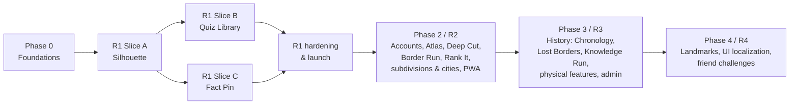

# Implementation Roadmap

Delivery is organized as **complete playable slices**. Each slice runs from content to engine to UI to tests to deploy. R1 proves the shared platform with three distinctly different games: a typed and map quiz, a deduction game, and a free-pin fact game. Later phases expand toward the full vision.

Every task names its **governing spec** and **acceptance criteria**. A task is done per [TESTING_AND_ACCEPTANCE §8](TESTING_AND_ACCEPTANCE.md#8-definition-of-done-per-task).

## Phase overview

## Phase 0 — Foundations

There is no public release in this phase. The output is a deployable shell with the shared packages, ready for the first slice.

| Task | Title | Depends on | Governing spec | ACs |
|---|---|---|---|---|
| T0.1 | Monorepo scaffold (pnpm, Turborepo, TS strict, ESLint boundaries, Prettier), Next.js app, CI workflow (`ci.yml`), Vercel project, preview deploys | — | [ARCHITECTURE §3, §5.1, §11](ARCHITECTURE.md#3-recommended-stack) | CI green on an empty app |
| T0.2 | Design tokens, fonts, base components (Button, Card, Dialog, Toast, Tabs, ChoiceGrid, AnswerInput shell), light/dark themes | T0.1 | [UX_AND_DESIGN §4–6](UX_AND_DESIGN.md#4-interaction-patterns-shared-components) | AC-PL-005, AC-PL-007, AC-PL-009 |
| T0.3 | `packages/schemas`: zod schemas for manifest, entity, geometry refs, facts, daily, GameResult, API payloads | T0.1 | [DATA_MODEL §2](DATA_MODEL.md#2-content-pack-schemas) | Schema unit tests |
| T0.4 | Content pipeline skeleton: fetch (NE 110m/50m/10m, Wikidata names, aliases and capitals, flag-icons), `sources.lock.yaml`, normalize, merge to stable IDs, build packs, upload to Blob (preview versions) | T0.3, T0.6 | [DATA_AND_CONTENT §2–4](DATA_AND_CONTENT.md#3-content-pipeline), [ARCHITECTURE §7](ARCHITECTURE.md#7-content-pipeline-technical) | DETERMINISM rule |
| T0.5 | Content validator with all R1 rules | T0.4 | [DATA_AND_CONTENT §10](DATA_AND_CONTENT.md#10-validation-rules-content-ci) | Each rule has a failing fixture test |
| T0.6 | **License verification:** confirm the terms of ❓/🟡 sources used in R1 (Wikidata CC0, World Bank CC BY 4.0, UN M49, Wikimedia pageviews). Record them in the source registry with the URL and date. | — | [DATA_AND_CONTENT §2](DATA_AND_CONTENT.md#2-source-inventory) | LICENSE_UNVERIFIED passes |
| T0.7 | `packages/game-kit`: seeds, sfc32/cyrb128, forks, shuffles, Repeat Guard, timer model, challenge codec, mastery update | T0.3 | [ARCHITECTURE §8–9](ARCHITECTURE.md#8-puzzle-generation-reproducibility-and-difficulty) | AC-PL-026, prng and challenge golden tables |
| T0.8 | `packages/name-matcher`: norm, index, keystroke/submit matching, prefix-hold, ambiguity, fuzzy thresholds | T0.3 | [quiz-library §5](games/quiz-library.md#5-answer-validation-and-interaction-rules) | AC-QZ-001…009, 021, 023 (unit level), golden table ≥ 300 rows |
| T0.9 | `packages/geo`: haversine, rhumb, sector8, proximity, point-in-polygon, distance-to-polygon, antimeridian handling | T0.3 | [silhouette §5.3](games/silhouette.md#53-distance-direction-proximity-normative-definitions), [fact-pin §5](games/fact-pin.md#5-answer-validation-and-interaction-rules) | AC-SH-001…004, AC-FP-001…003, 008 (unit level) |
| T0.10 | `GameMap` component: projections, SVG layers, zoom/pan, LOD switching, select mode, highlight mode, free-pin mode, tiny-target rings, loupe, spatial keyboard nav, patterns | T0.2, T0.9 | [ARCHITECTURE §6](ARCHITECTURE.md#6-map-rendering-geometry-projections-and-asset-delivery), [quiz-library §5.4](games/quiz-library.md#54-map-interaction-rules-map_click-and-type_prompted-with-highlight) | AC-QZ-011, AC-PL-008 |
| T0.11 | App shell: routes, nav (desktop/mobile), content loader (manifest, packs, cache), IndexedDB (Dexie stores), session persistence service, resume prompt, system states | T0.2, T0.3, T0.7 | [UX_AND_DESIGN §1–3, §8](UX_AND_DESIGN.md#1-information-architecture), [ARCHITECTURE §9](ARCHITECTURE.md#9-state-management-session-persistence-and-result-storage), [DATA_MODEL §2.10](DATA_MODEL.md#210-local-indexeddb-stores-dexie) | AC-PL-006, 011, 012 (with a dummy game), 013 |
| T0.12 | Postgres (Neon) + Drizzle setup, migrations pipeline, `/api/v1/health`, problem+json error helper, rate-limit rules, CSP and security headers | T0.1 | [ARCHITECTURE §12](ARCHITECTURE.md#12-security-and-privacy), [API_CONTRACTS §1–2, §4.1](API_CONTRACTS.md#1-conventions) | AC-PL-025 |

## Phase 1 — First playable release (R1)

**Goal:** a public launch with Silhouette, Quiz Library (Countries, Capitals, Flags, Continents & Regions) and Fact Pin, all unlimited, plus a guest profile, stats, challenges, reports, an optional daily, and accessibility and performance at target.

### Slice A — Silhouette (proves the deduction loop, geometry, Repeat Guard and results)

| Task | Title | Depends on | Governing spec | ACs |
|---|---|---|---|---|
| T1.1 | R1 country content: `core.countries` (sets, canonical names per the style guide, aliases incl. former and endonyms, ambiguity groups, capitals with roles, population and area), `content/sets`, `content/disputes.yaml` | T0.4, T0.5 | [DATA_AND_CONTENT §5–7](DATA_AND_CONTENT.md#5-names-aliases-and-languages) | SET_COUNT, ALIAS_COLLISION, CAPITAL_OUTSIDE pass |
| T1.2 | Derived geometry: ref points, silhouettes (main group, remote parts, overrides), adjacency (+ via, disputed), difficulty priors | T1.1 | [silhouette §5.3–5.4](games/silhouette.md#54-silhouette-geometry-rules-islands-overseas-territories-multipart-shapes), [DATA_AND_CONTENT §9](DATA_AND_CONTENT.md#9-difficulty-priors) | AC-SH-009, 010, REF_POINT_OUTSIDE, ADJ_ASYMMETRIC |
| T1.3 | Silhouette engine (generate, reduce, score, follow-ups, hints, Repeat Guard rules) | T0.7, T0.8, T0.9, T1.2 | [silhouette §2–7, §11](games/silhouette.md#2-rules-and-complete-gameplay-loop) | AC-SH-001…008, 011…013, 017 |
| T1.4 | Silhouette UI (play, follow-ups, Learn card, accessible description, result summary) | T0.10, T0.11, T1.3 | [silhouette §8, §10](games/silhouette.md#8-screens-and-state-transitions) | AC-SH-016, 018, 019, 020 |
| T1.5 | Results, stats and mastery (local): GameResult writes, `/me` overview, per-game stats, history list, mastery map | T0.11, T1.3 | [UX_AND_DESIGN §3.5, §7.1](UX_AND_DESIGN.md#71-statistics-r1-local), [DATA_MODEL §2.9](DATA_MODEL.md#29-game-result-client-and-server) | AC-PL-010 |
| T1.6 | Daily (Silhouette): schedule generator + validator, Daily hub `/daily`, daily summary, share text | T1.3 | [silhouette §11](games/silhouette.md#11-unlimited-play-and-repeat-prevention-behavior), [UX_AND_DESIGN §9](UX_AND_DESIGN.md#9-sharing) | AC-SH-014, 015, AC-PL-024 |
| T1.7 | Challenges: long codes, `/c/[code]`, `POST/GET /api/v1/challenges`, short codes, comparison view | T0.7, T0.12, T1.4 | [ARCHITECTURE §8.4](ARCHITECTURE.md#84-challenge-codes), [API_CONTRACTS §4.2](API_CONTRACTS.md#42-challenges-public-r1) | AC-PL-015, 016, 017 |

### Slice B — Quiz Library (proves typed input, map clicking, the template system and the review loop)

| Task | Title | Depends on | Governing spec | ACs |
|---|---|---|---|---|
| T1.8 | Quiz engine: templates, scopes, formats TYPE_ALL, TYPE_PROMPTED, MAP_CLICK, MULTIPLE_CHOICE, timers, scoring, PB keys, Practice my misses, Learn mode | T0.7, T0.8, T1.1 | [quiz-library §2–7, §11](games/quiz-library.md#2-rules-and-complete-gameplay-loop) | AC-QZ-005…010, 013, 015…019, 022 |
| T1.9 | Flags content: flag SVG pack, confusables list | T1.1 | [quiz-library §6.3](games/quiz-library.md#63-difficulty) | AC-QZ-019 |
| T1.10 | Quiz UI: library browser, configure panel, play screens per format, review screen, accessible variant | T0.10, T0.11, T1.8 | [quiz-library §8, §10](games/quiz-library.md#8-screens-and-state-transitions) | AC-QZ-001…004 (E2E), 011, 012, 014, 020, 024 |
| T1.11 | Catalog `/play`: search, filters, favorites (local), Home page modules | T0.11, T1.10 | [UX_AND_DESIGN §3.1–3.2](UX_AND_DESIGN.md#31-home-) | AC-PL-001, 019, 020 |

### Slice C — Fact Pin (proves free-pin input, the fact bank and source attribution)

| Task | Title | Depends on | Governing spec | ACs |
|---|---|---|---|---|
| T1.12 | Fact bank v1: ≥ 400 curated facts meeting quotas + generated capitals/cities facts, a fact authoring guide and template in `content/facts/README.md` | T0.5, T1.1 | [fact-pin §4](games/fact-pin.md#4-data-requirements), [DATA_AND_CONTENT §8](DATA_AND_CONTENT.md#8-editorial-workflow-and-corrections) | AC-FP-013, QUOTA, FACT_NO_SOURCE |
| T1.13 | Fact Pin engine (selection, run composition, scoring, hints, timer, daily schedule) | T0.7, T0.9, T1.12 | [fact-pin §2–7, §11](games/fact-pin.md#2-rules-and-complete-gameplay-loop) | AC-FP-001…010, 014, 015 |
| T1.14 | Fact Pin UI (pin mode, loupe, place-by-search, reveal, summary) | T0.10, T1.13 | [fact-pin §8, §10](games/fact-pin.md#8-screens-and-state-transitions) | AC-FP-005, 011, 012, 016 |

### R1 hardening and launch

| Task | Title | Depends on | Governing spec | ACs |
|---|---|---|---|---|
| T1.15 | Reports: dialog, `POST /api/v1/reports`, dedupe job, `/about/corrections` changelog generator | T0.12 | [UX_AND_DESIGN §10](UX_AND_DESIGN.md#10-content-corrections-player-facing), [API_CONTRACTS §4.3](API_CONTRACTS.md#43-reports-public-r1) | AC-PL-018 |
| T1.16 | Settings page, data export/import (guest) | T0.11 | [UX_AND_DESIGN §3.6](UX_AND_DESIGN.md#36-settings-settings) | AC-PL-021, 023 |
| T1.17 | Offline and error states (R1 level) across all three games | T1.4, T1.10, T1.14 | [UX_AND_DESIGN §8](UX_AND_DESIGN.md#8-system-states-loading-empty-error-offline-interrupted) | AC-PL-014 |
| T1.18 | Static pages: About, Rules (incl. "What counts as a country", "How scoring works"), Sources (generated), Privacy | T0.4 | [DATA_AND_CONTENT §2.1, §6](DATA_AND_CONTENT.md#21-licensing-rules) | AC-PL-022 |
| T1.19 | Accessibility pass + manual screen-reader checklist | all R1 UI | [TESTING_AND_ACCEPTANCE §5](TESTING_AND_ACCEPTANCE.md#5-accessibility-verification) | AC-PL-004, 006, 007, 008 |
| T1.20 | Performance pass (budgets, LOD tuning, code splitting) | all R1 UI | [ARCHITECTURE §13](ARCHITECTURE.md#13-performance-targets) | AC-PL-002, AC-PL-003 |
| T1.21 | Launch: content release `YYYY.MM.0`, production deploy, uptime checks, Sentry, analytics | all | [TESTING_AND_ACCEPTANCE §9](TESTING_AND_ACCEPTANCE.md#9-release-exit-criteria) | R1 exit criteria |

**Recommended order:** T0.x → T1.1–T1.7 (Slice A shippable as an internal alpha) → T1.8–T1.11 → T1.12–T1.14 → T1.15–T1.21. Slices B and C may run in parallel after Slice A.

## Phase 2 — R2: Accounts, exploration and breadth

| Task | Title | Depends on | Governing spec | ACs |
|---|---|---|---|---|
| T2.1 | Auth (magic link + Google), `/signin`, `users` and auth tables, CSRF | R1 | [ARCHITECTURE §12](ARCHITECTURE.md#12-security-and-privacy), [DATA_MODEL §3.1](DATA_MODEL.md#31-identity-r2) | — |
| T2.2 | Sync: results batch, `/sync`, merge semantics, sync queue UI, active sessions (untimed) | T2.1 | [API_CONTRACTS §4.4–4.8](API_CONTRACTS.md#44-current-user-session-r2) | AC-PL-027, 028 |
| T2.3 | Account export/delete | T2.1 | [API_CONTRACTS §4.9](API_CONTRACTS.md#49-account-data-session-r2) | AC-PL-029 |
| T2.4 | PWA: service worker precache, offline play, background sync | R1 | [UX_AND_DESIGN §8](UX_AND_DESIGN.md#8-system-states-loading-empty-error-offline-interrupted) | AC-PL-030 |
| T2.5 | Achievements + opt-in streaks | T1.5 | [UX_AND_DESIGN §7.2–7.3](UX_AND_DESIGN.md#72-achievements-r2) | AC-PL-031, 032 |
| T2.6 | Telemetry endpoint, aggregation cron, calibration release job | T0.12 | [API_CONTRACTS §4.6](API_CONTRACTS.md#46-anonymous-answer-telemetry-r2), [ARCHITECTURE §10](ARCHITECTURE.md#10-background-jobs) | AC-PL-033 |
| T2.7 | Indicators pack (World Bank etc.) + attributes pack (languages, flag features, driving side…) | T0.6 | [DATA_AND_CONTENT §2](DATA_AND_CONTENT.md#2-source-inventory) | INDICATOR_COVERAGE |
| T2.8 | Rank It | T2.7 | [rank-it.md](games/rank-it.md) | AC-RK-001…012 |
| T2.9 | Border Run (+ crossings content) | T1.2 | [border-run.md](games/border-run.md) | AC-BR-001…013 |
| T2.10 | Deep Cut (prompt generator, rarity, reveal) | T2.6, T2.7 | [deep-cut.md](games/deep-cut.md) | AC-DC-001…015 |
| T2.11 | Atlas Explorer (layers, cards, filters, compare, table view, true-size, quiz-me) | T2.7, T2.8 | [atlas-explorer.md](games/atlas-explorer.md) | AC-AE-001…014 |
| T2.12 | Quiz Library R2: TILE_SELECT, MATCH, lives modifier, Daily quiz, extra answer languages | T1.8 | [quiz-library §2.2, §3](games/quiz-library.md#22-rules-by-format) | New AC rows added to quiz-library §12 in the same PR |
| T2.13 | Subdivision packs (12 countries) + subdivision and subdivision-capital templates; Silhouette and Border Run regional pools | T2.12 | [quiz-library §4.2](games/quiz-library.md#42-templates) | GEOM_MISSING for the subdivision sets |
| T2.14 | Cities pack (GeoNames) + city templates + Rankings templates | T2.12 | [quiz-library §4.2](games/quiz-library.md#42-templates) | — |
| T2.15 | Silhouette Neighbors follow-up + proximity heat-map assist | T1.4 | [silhouette §3](games/silhouette.md#3-modes-and-configuration) | — |

## Phase 3 — R3: History and depth

| Task | Title | Depends on | Governing spec | ACs |
|---|---|---|---|---|
| T3.1 | **Resolve Q-04** (historical geometry license): decide GPL pack isolation vs an alternative source; evaluate CShapes 2.0 terms | — | [OPEN_QUESTIONS_AND_RISKS Q-04](OPEN_QUESTIONS_AND_RISKS.md#q-04-historical-geometry-license) | AC-LB-013 |
| T3.2 | Event bank (≥ 1,500) + people + Chronology | R2 | [chronology.md](games/chronology.md) | AC-CH-001…014 |
| T3.3 | History packs (slices, polities, aliases with validity) + Lost Borders | T3.1 | [lost-borders.md](games/lost-borders.md) | AC-LB-001…013 |
| T3.4 | Quiz Library physical-feature templates (rivers, mountains, waters, islands, deserts) + line/point rendering | T0.10 | [quiz-library §4.2](games/quiz-library.md#42-templates) | New ACs added in the PR |
| T3.5 | Historical-states quiz template | T3.3 | [quiz-library §4.2](games/quiz-library.md#42-templates) | — |
| T3.6 | Knowledge Run + `microRound` for every game | T3.2, T3.3 | [knowledge-run.md](games/knowledge-run.md) | AC-KR-001…012 |
| T3.7 | Admin console (reports queue, rulings, fact editor, PR creation via GitHub App) + public rulings page | T1.15 | [API_CONTRACTS §4.10](API_CONTRACTS.md#410-admin-editor-r3), [DATA_AND_CONTENT §8](DATA_AND_CONTENT.md#8-editorial-workflow-and-corrections) | AC-PL-034 |
| T3.8 | Deep Dive variant + retroactive ruling credits | T2.10, T3.7 | [deep-cut §3](games/deep-cut.md#3-modes-and-configuration) | — |
| T3.9 | Atlas: historical year slider, physical layers, globe view | T3.3, T3.4 | [atlas-explorer §3](games/atlas-explorer.md#3-modes-and-configuration) | — |

## Phase 4 — R4: Breadth and reach

| Task | Title | Notes |
|---|---|---|
| T4.1 | Landmarks quiz family with licensed images (Wikimedia Commons per-image credits) | Image license pipeline. Each image needs a credit. |
| T4.2 | UI localization (start with es, fr, de) | i18n framework already reserved: all strings go through `t()` from R1 |
| T4.3 | Friend challenge comparisons (private groups via challenge links, no public leaderboards) | Requires accounts |
| T4.4 | Reconsider monetization **only** as a separate decision that keeps core play free | [PRODUCT_VISION §6](PRODUCT_VISION.md#explicit-exclusions) |

## Feature → phase index

| Feature | Phase |
|---|---|
| Guest play, local stats, mastery, history, favorites | R1 |
| Unlimited modes in all R1 games, Practice, seeded links, optional Silhouette and Fact Pin dailies | R1 |
| Reports + public changelog | R1 |
| Optional accounts, sync, cross-device untimed resume, export/delete | R2 |
| Achievements, opt-in streaks | R2 |
| PWA offline | R2 |
| Telemetry-based calibration | R2 |
| Extra answer languages | R2 |
| Admin console, public rulings | R3 |
| UI localization | R4 |
| Public leaderboards, monetization | Not planned |
