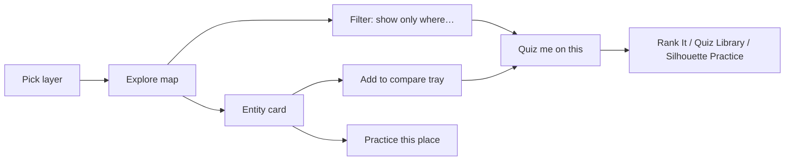

# Atlas Explorer

| Field | Value |
|---|---|
| Game ID | G-AE |
| Slug / route | `/explore` (map), `/explore/<entity-id>` (deep link to an entity card, e.g. `/explore/country:PER`) |
| Phase | **R2**. R3: historical year slider (from Lost Borders data) and physical-feature layers. |
| Inspiration | The brief's "interactive fact map". Fact Map itself appears to be a pin game ([REFERENCE_RESEARCH §2](../REFERENCE_RESEARCH.md#2-fact-map-factmapworld)), so everything here is **Proposed**. |
| Depends on | `GameMap` (select + layer modes), packs `core.countries`, `indicators`, `facts.v1`, `geo.world.50m/10m`, `cities`, generators from Quiz Library / Rank It / Silhouette (to "turn into a challenge"). |
| Governing ACs | AC-AE-001 … AC-AE-014 |

## 1. Purpose and player experience

- A calm, explorable **reference map** that answers "what's here, how does it compare, and what's interesting about it?". Every view is one click away from a playable challenge.
- It is also the platform's **hub**: result screens across the games link to "Learn more in Atlas".
- **Session:** open-ended. **Personas:** Learner, History Buff, Casual.

## 2. Rules and complete gameplay loop

Atlas Explorer is not scored. The loop is: **choose a layer → explore (hover, tap, search, filter) → open entity cards → compare → "Quiz me on this"** (which hands off to a game with a generated configuration).



## 3. Modes and configuration

| Layer group | Layers (R2) | Encoding |
|---|---|---|
| Political | Countries and territories (default), continents, UN subregions | Categorical fill (8-color colorblind-safe palette, plus a pattern for "disputed") |
| Indicators (choropleth) | Population, area, population density, GDP per capita (current US$), life expectancy, urban population %, forest area %, highest point elevation | 5 quantile classes (or log-scaled for population and area). Sequential palette. The legend shows values. |
| Categorical attributes | Landlocked, driving side, official language (top 12 + "other"), currency union membership, number of time zones | Categorical fill + legend + pattern for "no data" |
| Points | Capitals, 300 largest cities, Fact Pin facts already seen | Symbol layers with clustering at low zoom |
| Physical (R3) | Rivers, lakes, mountain ranges, deserts | Lines and areas |
| Historical (R3) | Year slider over the historical basemap slices | Polity fills with uncertainty blur where `BORDERPRECISION = 1` |

| Option | Values | Default |
|---|---|---|
| Labels | Off, Countries, Countries + capitals | Countries |
| Projection | Equal Earth (default), Natural Earth I, Orthographic globe (R3) | Equal Earth |
| Classification | Quantile, Equal interval, Log | Layer default |
| Color scheme | Default, High contrast | Default |

## 4. Data requirements

- `indicators` pack: `{indicator_id, entity_id, value, year, source_id}`. Sources: World Bank WDI (CC BY 4.0) for population, GDP per capita, life expectancy, urbanization and forest area. Area from World Bank or the UN Statistics Division. Elevation from Wikidata (CC0). Indicator records always carry the data year. Values older than 5 years show a "data from 2019" note.
- Entity cards use `core.countries`, `facts.v1` (facts whose `entities` include the entity) and `cities`.
- Coverage: an indicator layer must cover ≥ 90% of sovereign-197 entities. Otherwise it is not shipped. Missing values show the hatched "no data" pattern.

## 5. Answer validation and interaction rules

| Interaction | Desktop | Touch | Keyboard |
|---|---|---|---|
| Inspect | Hover → tooltip (name + layer value) | Tap → tooltip + "Open card" | Spatial arrow navigation → tooltip announced |
| Open card | Click | "Open card" in the tooltip, or a second tap | `Enter` |
| Compare | Shift+click, or "＋ Compare" in the card | "＋ Compare" in the card | `C` |
| Search | `/` focuses the search box. Results: countries, territories, capitals, cities and features. Selecting a result flies to it and opens its card. | Same | Same |
| Filter | "Show only where…" builder: `<indicator|attribute> <op> <value>`, up to 3 clauses joined with AND. Non-matches are dimmed to 25% opacity **and** desaturated. Shows the match count. | Bottom sheet | Form controls |

The compare tray holds a maximum of 3 entities. Adding a 4th replaces the oldest, with a toast.

**True-size overlay (R2):** from a card, "Drag outline" picks up the entity's outline re-projected with an azimuthal equal-area projection centered on the pointer, so area stays true as you move it across latitudes. Drop it anywhere to compare. `Esc` clears it.

## 6. Scoring and difficulty

Not applicable: Atlas is unscored. Exploration progress is tracked as **Discovered**: an entity card opened at least once. The profile shows "Discovered 132 / 197 countries" and per-continent counts. Achievements are defined in [UX_AND_DESIGN §7](../UX_AND_DESIGN.md#7-progress-statistics-achievements-and-streaks).

## 7. Hints and feedback

Not applicable (no puzzle). Feedback consists of tooltips, card contents and filter match counts. Facts shown in cards are marked **seen** for Fact Pin's Repeat Guard, so Atlas browsing doesn't spoil upcoming Fact Pin rounds unknowingly. The card says "Facts you read here won't come up in Fact Pin for a while."

## 8. Screens and state transitions

```
Desktop ≥1024
┌──────────────────────────────────────────────────────────────────────┐
│ Atlas   [Search places… /]    Layer: [Population density ▾]  [Filter]│
├────────────────────────────────────────────────┬─────────────────────┤
│                                                │ Peru  🇵🇪            │
│                 MAP (choropleth)               │ Capital  Lima        │
│                                                │ Pop.  34.4M (2024,WB)│
│ Legend: ▢<10 ▢10–40 ▢40–100 ▢100–300 ▢>300/km²│ Area  1,285,216 km²  │
│                                                │ Neighbors (5) …      │
│ Compare: [Peru ✕][Chile ✕]  [Compare →]        │ Facts (3) …          │
│                                                │ [Practice this place]│
│                                                │ [＋ Compare]          │
└────────────────────────────────────────────────┴─────────────────────┘
Mobile: map full-screen; card = draggable bottom sheet (peek 30%, full 90%); layer picker = sheet.
```

**"Quiz me on this" mapping:**

| Context | Generated challenge |
|---|---|
| Choropleth layer + optional filter | Rank It: "Order by population density" with 5 entities from the filtered set |
| Categorical layer (value V) + scope | Quiz Library TILE_SELECT: "Select all landlocked countries in Africa" |
| Points layer (capitals) | Quiz Library MAP_CLICK on capitals of the current viewport's continent |
| Compare tray (2–3 entities) | Rank It pairwise round on the current layer's indicator |
| Entity card | Silhouette Practice with that target, plus Quiz Library TYPE_PROMPTED items about it (capital, flag) |

The URL state (`?layer=pop-density&filter=...&sel=country:PER`) is shareable.

## 9. Edge cases

| Case | Expected behavior |
|---|---|
| An indicator value is missing for an entity | Hatched "no data" pattern. The tooltip says "No data (World Bank 2024)". |
| A disputed area (e.g. Western Sahara, Kashmir) | Drawn with the "disputed" pattern and a note listing claimants. See [DATA_AND_CONTENT §6](../DATA_AND_CONTENT.md#6-what-counts-as-a-country). |
| A filter matches 0 entities | Empty state: "No places match. Try loosening 'population > 500M'." plus a [Reset filter] button |
| A filter matches fewer than 4 entities, then "Quiz me" | The challenge generator requires ≥ 4. The button is disabled with a tooltip explaining why. |
| Deep link to an unknown entity ID | Map loads normally with a toast "Place not found" |
| A tiny entity (Monaco) | Tiny-target ring rules from [quiz-library §5.4](quiz-library.md#54-map-interaction-rules-map_click-and-type_prompted-with-highlight) apply |

## 10. Accessibility and mobile behavior

- **The map is never the only way in.** A **Table view** toggle shows the current layer as a sortable, filterable data table (entity, value, rank, year, source). Every capability (filter, compare, quiz me) works from the table.
- Choropleths use sequential palettes that pass a CVD simulation (deuteranopia, protanopia, tritanopia). Each class also has a distinct value label in the legend and in tooltips.
- Bottom sheets trap focus correctly and close with `Esc` or a swipe down.

## 11. Unlimited-play and repeat-prevention behavior

Exploration is inherently unlimited. Generated challenges use the target game's generator, seeded and subject to that game's Repeat Guard. Challenges launched from Atlas are recorded with `origin: "atlas"`.

## 12. Acceptance criteria

| ID | Given / When / Then | Example |
|---|---|---|
| AC-AE-001 | Every indicator value shows source and year | Peru population tooltip includes "World Bank" and "2024" (or the pack's year) |
| AC-AE-002 | The filter dims non-matches and shows a count | `population > 100,000,000` → count equals the pack's computed count, and non-matches are dimmed |
| AC-AE-003 | Table view parity | Sorting the table by density descending lists the same top 5 as the map legend's top class |
| AC-AE-004 | Compare tray max 3 | Adding a 4th replaces the oldest, with a toast |
| AC-AE-005 | Quiz me on a categorical layer | Landlocked + Africa → TILE_SELECT where correct tiles = African landlocked entities in the pack |
| AC-AE-006 | Quiz me disabled under 4 matches | A filter with 3 matches → disabled button with an explanation |
| AC-AE-007 | Deep link | `/explore/country:PER` opens with the Peru card visible |
| AC-AE-008 | Facts marked seen | Opening Peru's card with 3 facts → those 3 fact IDs are in the Fact Pin seen set |
| AC-AE-009 | Discovered counter | Opening 3 new country cards increases "Discovered" by 3, once each |
| AC-AE-010 | True-size overlay keeps area | Dragging Greenland's outline to the equator renders an area within 1% of its true km² (measured in the equal-area frame) |
| AC-AE-011 | Missing data pattern | An entity without an indicator value renders the hatched pattern, and the tooltip says "No data" |
| AC-AE-012 | Search | Typing "lima" and pressing Enter flies to Lima and opens Peru's card with Lima marked as the capital |
| AC-AE-013 | URL state round-trip | Copying the URL and opening it in a new session restores layer, filter and selection |
| AC-AE-014 | Keyboard-only | Playwright: search → open card → add to compare → open the compare view, using only keys |
