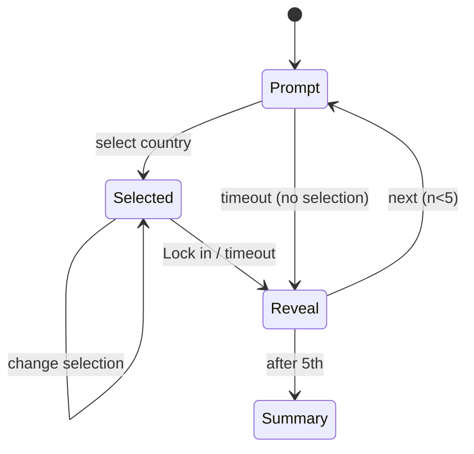

# Deep Cut

| Field | Value |
|---|---|
| Game ID | G-DC |
| Slug / route | `/play/deep-cut` |
| Phase | **R2**. R3: "Deep Dive" multi-answer variant and the public Rulings page. |
| Inspiration | Farflung (Observed: [REFERENCE_RESEARCH §3](../REFERENCE_RESEARCH.md#3-farflung-farflunggame)) |
| Depends on | `GameMap` (select), Name Matcher, the attribute graph in `core.attributes`, aggregate answer telemetry ([API_CONTRACTS §4.6](../API_CONTRACTS.md#46-anonymous-answer-telemetry-r2)), Repeat Guard, Timer service |
| Governing ACs | AC-DC-001 … AC-DC-015 |

## Observed vs Proposed

| Mechanic | Farflung (Observed) | Deep Cut |
|---|---|---|
| Prompt with several correct countries | ✅ | Same core idea |
| One answer per prompt, placed on the map | ✅ Pin + "Drop pin" | Map select **or** typed answer (Proposed: typing for accessibility and speed) |
| Same country may answer several prompts | ✅ | Same |
| Rarity tiers (5 levels) based on how seldom answers come to mind | ✅ (method not published) | 5 tiers with **original names** (Obvious, Solid, Sharp, Deep, Deep Cut) and a **published method** (Proposed, §6) |
| At least one top-rarity answer per prompt | ✅ | Guaranteed by construction (§6.2) |
| 60 s timer, 30 s on Difficulty | ✅ | Same values: 60 / 30 / Off |
| Score as kilometres travelled | ✅ | **Points** (Proposed: avoids confusion with real distance in other games) |
| Five prompts daily, plus past week and an untimed practice round | ✅ | **Unlimited generated prompts** (Proposed), Daily optional |
| End-of-run reveal of all valid answers | ✅ ("camp") | Same, plus pick-rate bars per answer once calibrated (Proposed) |
| Dispute form and Rulings page | ✅ | Platform corrections flow + public changelog (R3) |
| Deep Dive: name up to 3 answers, any wrong zeroes the prompt | — | **Proposed** (R3) |

## 1. Purpose and player experience

- Reward **breadth** of knowledge. Any player can name Germany for "German is an official language". Deep Cut rewards remembering Liechtenstein.
- **Arc:** read the prompt → obvious answer → resist it → hunt for a rarer one → gamble on uncertainty → the reveal shows every answer and how rare yours was.
- **Run:** 5 prompts, about 3–5 minutes. **Personas:** Completionist, Daily Puzzler.

## 2. Rules and complete gameplay loop

1. A run has **5 prompts**. Each prompt has between **4 and 30** valid answers in the active country set.
2. For each prompt, the player selects **one** country (map tap + **Lock in**, or type + Enter). The selection can be changed until locked.
3. A valid answer scores by its rarity tier (§6). An invalid answer scores 0 and shows why ("Austria: German is official, but this prompt asked for *co-official with French*"). An empty answer at timeout scores 0.
4. When the timer runs out, the current selection (if any) is locked automatically.
5. After each prompt, a reveal shows the player's tier and **all valid answers** grouped by tier, plus a one-line explanation of the prompt's data.
6. After 5 prompts, the summary shows the total, tiers earned and a share card.



## 3. Modes and configuration

| Mode | Description | Phase |
|---|---|---|
| **Run** (default, unlimited) | 5 generated prompts, then Play again | R2 |
| **Daily** | The same 5 prompts per local date | R2 |
| **Practice** | Untimed, with the valid answer count shown, and "Show me a rarer one" after locking | R2 |
| **Deep Dive** | Up to 3 distinct answers per prompt. Points are summed, but any invalid answer makes the prompt score 0. | R3 |
| **Seeded challenge** | A link reproduces the 5 prompts | R2 |

| Option | Values | Default |
|---|---|---|
| Timer | 60 s, 30 s, Off | 60 s |
| Country set | as Quiz Library | sovereign-197 |
| Prompt families | multi-select (§4.2) | All |

## 4. Data requirements

### 4.1 Attribute graph (`core.attributes`)

Per country: official languages (Wikidata P37, CC0, editorially reviewed), land neighbors (`core.adjacency`), coastline bodies of water (curated), flag colors and features (curated: colors ⊂ {red, white, blue, green, yellow, black, orange}, has star, has crescent, has coat of arms, has animal), crossed by the equator / Tropic of Cancer / Tropic of Capricorn / Prime Meridian (computed from geometry), landlocked (computed), continent, population and area bands (indicators), currency (ISO 4217), monarchy (curated), drives on the left (curated), name properties (first letter, ends with "-stan", number of words).

### 4.2 Prompt templates (families)

| Family | Template | Example | Valid answers (approx.) |
|---|---|---|---|
| Language | "{language} is an official language" | Portuguese | 9 |
| Neighbors | "Borders {country}" | Borders China | 14 |
| Two-attribute | "In {continent} and {attribute}" | In Africa and landlocked | 16 |
| Flags | "Flag contains {color} and {feature}" | Green and a star | 15–25 |
| Lines | "Crossed by the {line}" | Crossed by the equator | 13 |
| Water | "Has a coastline on the {sea}" | Mediterranean | 21 |
| Names | "Name ends in -stan" / "Name is a single word starting with {letter}" | Starts with M | 18 |
| Rankings | "Among the 20 largest by area in {continent}" | — | 20 |

The generator instantiates each template over the attribute values and keeps only instances with **4–30** valid answers. Estimated pool: ≥ 1,500 prompts.

### 4.3 Prompt record

```json
{
  "id": "prompt:lang-portuguese",
  "family": "language",
  "text": "Portuguese is an official language",
  "answers": ["country:PRT","country:BRA","country:AGO","country:MOZ","country:CPV","country:GNB","country:STP","country:TLS","country:GNQ"],
  "explanation": "Official status per national constitutions (Wikidata P37, reviewed 2026-09).",
  "rarity_prior": {"country:BRA": 0.95, "country:PRT": 0.92, "country:AGO": 0.55, "country:MOZ": 0.52, "country:CPV": 0.30, "country:GNB": 0.22, "country:TLS": 0.18, "country:STP": 0.15, "country:GNQ": 0.06}
}
```

## 5. Answer validation and interaction rules

- Map select uses [quiz-library §5.4](quiz-library.md#54-map-interaction-rules-map_click-and-type_prompted-with-highlight). Typed answers use the Name Matcher. The selection is shown as a chip ("Selected: Cape Verde") before locking.
- Validity is checked against the prompt's `answers` for the active country set only. A territory selected in a sovereign set gets: "Not in this game's country set."
- Feedback on an invalid answer explains with data: "Spain: Portuguese is not an official language."

## 6. Scoring and difficulty

### 6.1 Points by tier

| Tier | Points | Glyph |
|---|---|---|
| Obvious | 100 | ◔ |
| Solid | 250 | ◑ |
| Sharp | 450 | ◕ |
| Deep | 700 | ● |
| Deep Cut | 1000 | ◆ |

Run maximum = 5,000.

### 6.2 Rarity computation (published in the "How rarity works" help page)

1. **Prior obviousness** `o(answer, prompt) ∈ [0, 1]` = `0.6 × familiarity(entity) + 0.4 × typicality(entity, prompt)`.
   - `familiarity` = the entity's normalized recognition prior ([DATA_AND_CONTENT §9](../DATA_AND_CONTENT.md#9-difficulty-priors)), where 1 = most familiar.
   - `typicality` is family-specific. Language: the share of the population speaking that language. Neighbors: the shared border length divided by the target's total land border. Flags: 1 if the feature is dominant, 0.5 otherwise. Default: 0.5. Editors may override it.
2. **Empirical pick rate** `f(answer, prompt)` = the share of valid answers to this prompt that chose this entity, from anonymous telemetry. It is counted once `n ≥ 1` valid answers exist.
3. **Blended obviousness** `b = w × f_norm + (1 − w) × o`, where `w = min(1, n / 300)` and `f_norm = f / max_f` within the prompt.
4. **Tiers:** sort the k valid answers by ascending `b` (least obvious first). The cumulative cut points are `c_i = round(k × 0.2 × i)` for i = 1…4, with `c_1` forced to at least 1, and `c_5 = k`. The answers in positions [0, c₁) are **Deep Cut**, [c₁, c₂) Deep, [c₂, c₃) Sharp, [c₃, c₄) Solid and [c₄, k) Obvious. So every prompt has **at least one Deep Cut** answer, and a band may be empty.
5. Tiers are recomputed nightly ([ARCHITECTURE §10](../ARCHITECTURE.md#10-background-jobs)). A run's score uses the tiers **at the time of play** (they are stored with the result).

Worked example (9 Portuguese-official answers, prior only): sorted by ascending `o`: GNQ, STP, TLS, GNB, CPV, MOZ, AGO, PRT, BRA. Cumulative cut points: round(1.8) = 2, round(3.6) = 4, round(5.4) = 5, round(7.2) = 7, and 9. So Deep Cut = GNQ, STP. Deep = TLS, GNB. Sharp = CPV. Solid = MOZ, AGO. Obvious = PRT, BRA. Picking Timor-Leste → **700**.

### 6.3 Difficulty

Difficulty is implicit (the player chooses how deep to go). The generator balances runs: each run has 5 different families, with mean prompt "breadth" (answer count) between 8 and 20.

## 7. Hints and feedback

- Practice mode only: "How many valid answers?" (count) and "Show one Solid answer". There are no hints in a scored Run, because the challenge is recall.
- Reveal: valid answers in tier columns (glyph + name). The player's pick is highlighted with an outline and the label "You". Once calibrated, pick-rate bars show "12% of players".

## 8. Screens and state transitions

```
Mobile
┌──────────────────────────────┐
│ Deep Cut   Prompt 2/5  ⏱ 41  │
│ "Portuguese is an official   │
│  language"                   │
│ ┌──────────────────────────┐ │
│ │          MAP             │ │
│ └──────────────────────────┘ │
│ Selected: Timor-Leste        │
│ [Type instead]  [ Lock in ]  │
└──────────────────────────────┘
Reveal: "● Deep: +700"  then tier columns; [Next prompt]
```

## 9. Edge cases

| Case | Expected behavior |
|---|---|
| A prompt's validity changes after a data correction | Results keep their stored score. New runs use the corrected answers. The changelog notes it. |
| A player locks in a correct answer that was *added* later by a ruling | Retroactive credit is applied to stored results via a correction job (R3, with accounts only). The result shows "Updated by ruling R-0042". |
| Tied `b` values | Tie-break by `entity id` ascending (deterministic) |
| A prompt with exactly 4 answers | Tiers: cut points round(0.8) = 1, round(1.6) = 2, round(2.4) = 2, round(3.2) = 3 → Deep Cut 1, Deep 1, Sharp 0, Solid 1, Obvious 1 (an empty band is allowed) |
| Timer expires mid-typing | The typed text is not submitted. Only a locked or selected country counts. |
| The same country for two prompts | Allowed (Observed rule) |

## 10. Accessibility and mobile behavior

Typed input is a first-class alternative to the map. Tier glyphs plus text labels mean color is never needed. The timer can be turned off. A 10 s warning is announced once. The map uses tiny-target rings.

## 11. Unlimited-play and repeat-prevention behavior

- Prompts are drawn from about 1,500 instances. The Repeat Guard excludes prompts from the last 300 played (per player) and never repeats a family within a run.
- The daily schedule is precomputed for 365 days (no prompt reused within 180 days).
- If telemetry is unavailable (offline, or opted out), the prior-only tiers are used and the result is marked "provisional rarity".

## 12. Acceptance criteria

| ID | Given / When / Then | Example |
|---|---|---|
| AC-DC-001 | Tier banding | The 9-answer Portuguese example gives exactly the tiers in §6.2 |
| AC-DC-002 | At least one Deep Cut | Every generated prompt with 4–30 answers has ≥ 1 Deep Cut answer |
| AC-DC-003 | Scoring | Timor-Leste on the example → 700 points |
| AC-DC-004 | Invalid explanation | Spain on the Portuguese prompt → 0 and the text "Portuguese is not an official language" |
| AC-DC-005 | Timeout with a selection | Selection Angola, timer 0 → locked, 250 points |
| AC-DC-006 | Timeout without a selection | → 0, reveal shown |
| AC-DC-007 | Typed alternative | Typing "cabo verde" + Enter selects Cape Verde |
| AC-DC-008 | Blend weight | n = 150 telemetry answers → w = 0.5 |
| AC-DC-009 | Generator answer bounds | No generated prompt has < 4 or > 30 answers |
| AC-DC-010 | Run family uniqueness | 5 prompts → 5 distinct families |
| AC-DC-011 | Repeat Guard | 300 consecutive prompts per player → no repeats |
| AC-DC-012 | Stored tier | The result stores the tier at play time, so a later recalibration doesn't change the displayed history |
| AC-DC-013 | Provisional rarity offline | Offline → result flagged "provisional" |
| AC-DC-014 | Same country reusable | Brazil valid for 2 prompts in a run → both scored |
| AC-DC-015 | Daily schedule validation | 365-day schedule, no prompt repeats within 180 days |
