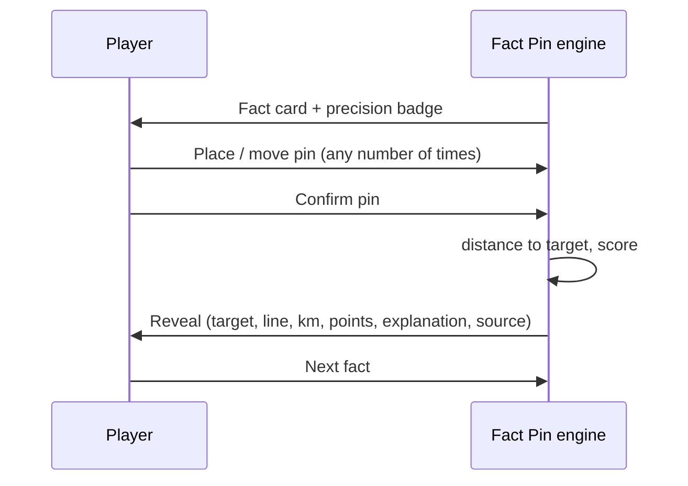

# Fact Pin

| Field | Value |
|---|---|
| Game ID | G-FP |
| Slug / route | `/play/fact-pin` |
| Phase | **R1** (Run of 5, Endless, Daily, category focus, optional timer). R2: generated fact templates from more datasets, and facts surfaced in Atlas Explorer. |
| Inspiration | Fact Map (Observed via secondary sources: [REFERENCE_RESEARCH §2](../REFERENCE_RESEARCH.md#2-fact-map-factmapworld)): read a fact, pin the location, up to 1,000 points by distance, per-fact precision target. **Proposed:** the published scoring formula, precision classes, hints, the unlimited fact bank, sources on every fact, and the endless mode. |
| Depends on | `GameMap` (free-pin mode), `geo` (distance to point and polygon), Repeat Guard, Timer service, packs `facts.v1`, `geo.world.50m`, `geo.world.10m` (zoomed), `core.countries`. |
| Governing ACs | AC-FP-001 … AC-FP-016 |

## 1. Purpose and player experience

- Connect knowledge (events, nature, culture, science) to *where* it happened. Each round teaches one fact and one location.
- **Arc:** read → "I think I know this…" → place a pin → reveal a line to the true spot → "oh, it was *there*" → explanation and source.
- **Round:** 15–40 s. A run of 5 takes about 2–3 minutes. Endless runs continue indefinitely.
- **Personas:** Daily Puzzler, Learner, History Buff.

## 2. Rules and complete gameplay loop

1. A **fact card** is shown. Its text describes something tied to a location without naming the target (§4.3). A **precision badge** shows how precise the pin must be: 🎯 Exact spot, 🏙 City, 🗺 Region, 🏳 Country, 🌊 Broad area.
2. The player places a pin (tap or click), can move it (drag, or tap elsewhere), and presses **Confirm pin** (or `Enter`).
3. The game reveals the target (a point with a tolerance ring, or a highlighted area), draws a geodesic line from the pin to the nearest point of the target, and shows the distance and score (§6).
4. A **reveal panel** shows the answer label, a 1–3 sentence explanation, and the source link(s).
5. **Next fact** continues. A run ends after 5 facts (Run mode) or when the player stops (Endless).



## 3. Modes and configuration

| Mode | Description | Phase |
|---|---|---|
| **Run of 5** (default) | 5 facts with a summary out of 5,000 | R1 |
| **Endless** | Continuous facts. Shows the running average and the best streak of ≥ 800-point pins. | R1 |
| **Daily 5** | The same 5 facts for everyone per local date, plus a share card | R1 |
| **Category focus** | Only History / Nature / Culture / Science / Sport / Capitals & cities | R1 |
| **Seeded challenge** | A link reproduces the 5 facts | R1 |

| Option | Values | Default |
|---|---|---|
| Categories | multi-select | All |
| Era (history facts) | Ancient (< 500), Medieval (500–1500), Early modern (1500–1800), Modern (1800–1945), Contemporary (1945–) | All |
| Timer | Off, 30 s, 15 s per fact | Off |
| Map labels | Off, Countries | Off (Easy: Countries) |
| Difficulty | Easy, Normal, Hard | Normal |

When the timer runs out, the current pin is confirmed automatically. With no pin placed, the fact scores 0.

## 4. Data requirements

### 4.1 Fact record

```json
{
  "id": "fact:0142",
  "text": "Roald Amundsen's expedition became the first to reach this point, in December 1911.",
  "answer_label": "South Pole",
  "category": "history",
  "era": "modern",
  "precision": "exact",
  "target": {"type": "point", "coords": [-90.0, 0.0]},
  "tolerance_km": 25,
  "reveal": "Amundsen's Norwegian party reached the geographic South Pole on 14 December 1911, about five weeks before Robert Falcon Scott's team.",
  "sources": [{"title": "Roald Amundsen (Q47538)", "url": "https://www.wikidata.org/wiki/Q47538", "license": "CC0"}],
  "difficulty": 0.35,
  "entities": ["place:south-pole"],
  "status": "published",
  "reviewed_at": "2026-10-01",
  "review_due": null
}
```

Area-target facts use `"target": {"type": "entity", "id": "country:PER"}` (the polygon comes from the geometry pack) or `{"type": "polygon", "ref": "feature:atacama"}` for physical features.

### 4.2 Fact bank size

| Source | Count at R1 | Notes |
|---|---|---|
| Curated facts written by editors | ≥ 400 (minimum 50 per category, and each continent ≥ 10%) | Written for Meridian, with sources cited |
| Generated "Capitals & cities" facts | 197 capitals + 300 largest cities | Template: "Pin the capital of Mongolia." / "Pin Lagos, Nigeria's largest city." |
| Total R1 | ≈ 900 | More than 180 Run-of-5 runs before the Repeat Guard relaxes |

### 4.3 Writing rules (fact text)

1. Never name the target, or a containing entity at the same or a coarser precision. (A City fact may name the country: "This Japanese city…")
2. Include at least one locating clue (era, neighbor, climate, language, event).
3. Use 12–35 words, present or past tense, and no trick questions.
4. Time-sensitive facts (records, "largest", "current") MUST have `review_due`, a date at most 12 months away ([DATA_AND_CONTENT §8](../DATA_AND_CONTENT.md#8-editorial-workflow-and-corrections)).
5. Every fact has ≥ 1 source, with a license that permits citing (fact text is our own writing, so the source is a citation, not a copy).

## 5. Answer validation and interaction rules

- **Pin placement:** the pin snaps to the click or tap position. Dragging moves it. A pin may be placed anywhere, including the ocean.
- **Precision of the pin:** stored as lat/lon to 4 decimals.
- **Distance to target:**
  - Point target: `d = max(0, haversine(pin, point) − tolerance_km)`.
  - Area target: `d = 0` if the pin is inside any polygon of the target (point-in-polygon on 1:10m geometry, antimeridian-aware). Otherwise `d` = geodesic distance from the pin to the nearest point on the target's boundary (computed on the 50m simplification, with a 0.5 km error budget).
- **Touch:** place with a single tap. Long-press opens a 3× loupe for fine placement. Confirm is a separate 48 px button, so an accidental tap never confirms.
- **Keyboard:** arrow keys move the pin by 1% of the viewport (Shift ×10). `Enter` confirms. `Tab` reaches a **search-to-place** field (see §10).

## 6. Scoring and difficulty

### 6.1 Formula

`score = round(1000 × exp(−d / s))`, where `d` is in km (§5) and `s` is the scale of the precision class:

| Precision | Badge | Target type | Default tolerance | Scale `s` |
|---|---|---|---|---|
| exact | 🎯 Exact spot | point | 25 km | 250 km |
| city | 🏙 City | point | 50 km | 400 km |
| region | 🗺 Region | polygon or point | 150 km (if point) | 700 km |
| country | 🏳 Country | country polygon | — (inside = full) | 1,000 km |
| broad | 🌊 Broad area | polygon (sea, desert, range) | — | 1,500 km |

Worked examples:

| Precision | Pin outcome | d | Score |
|---|---|---|---|
| city | 450 km from the city point | 450 − 50 = 400 | **368** |
| city | 150 km away | 100 | **779** |
| country | 500 km outside Peru's border | 500 | **607** |
| broad | 1,200 km from the Sahara's edge | 1,200 | **449** |
| exact | 55 km from the South Pole | 30 | **887** |
| country | inside the polygon | 0 | **1000** |

Run total = Σ (max 5,000). Ratings: ≥ 4,500 "Pinpoint", ≥ 3,500 "Sharp", ≥ 2,000 "On the map", otherwise "Exploring".

### 6.2 Difficulty

| Setting | Fact selection | Map |
|---|---|---|
| Easy | `difficulty < 0.4`. No `exact` precision facts. | Country labels on |
| Normal | All | No labels |
| Hard | `difficulty > 0.5` weighted ×3. Timer defaults to 30 s. | No labels and no country borders (coastlines only) |

## 7. Hints and feedback

| Hint | Effect | Cost |
|---|---|---|
| Continent | Highlights the continent containing the target | Max score for this fact becomes 700 |
| Country (only for exact, city or region precision) | Highlights the containing country | Max score becomes 400 |

The cost is a cap, not a deduction: `score = min(cap, formula)`.

**Reveal feedback:** the target is drawn (a point with a dashed tolerance ring, or an area with a hatched fill and outline), the line goes from the pin, and a label shows "450 km · 368 pts". Screen reader: "Your pin was 450 kilometres from Kyoto. 368 points. Kyoto, Japan: …explanation…".

## 8. Screens and state transitions

```
Desktop
┌───────────────────────────────────────────────────────────────────┐
│ ← Fact Pin · Run   Fact 2 / 5   1,368 pts           ⏱ off   [⋯]   │
├───────────────────────────────────────────────────────────────────┤
│ 🏙 City                                                           │
│ "This Japanese city was the imperial capital for over a thousand  │
│  years, until 1869."                                [Hint ▾]      │
├───────────────────────────────────────────────────────────────────┤
│                         WORLD MAP (pin mode)                      │
│                                 📍                                 │
├───────────────────────────────────────────────────────────────────┤
│                                        [ Confirm pin ]            │
└───────────────────────────────────────────────────────────────────┘
Mobile: fact card collapses to 3 lines with "more"; map fills; Confirm is a full-width bottom bar.
```

| State | Events → next state |
|---|---|
| `reading` | `PLACE` → `placed` |
| `placed` | `PLACE`/`MOVE` → `placed`; `CONFIRM`/`TIMEOUT` → `revealed` |
| `reading` | `TIMEOUT` → `revealed` (score 0) |
| `revealed` | `NEXT` → `reading` (next fact) or `summary` (after fact 5 in Run mode) |
| `summary` | `PLAY_AGAIN` → `reading` |

The summary lists all 5 facts with map thumbnails, scores, and **[Explore in Atlas]** links (R2).

## 9. Edge cases

| Case | Expected behavior |
|---|---|
| Pin placed exactly on a country border, for a country-precision fact | Point-in-polygon with boundary counted as inside: 1000 |
| Target spans the antimeridian (e.g. Fiji) | Distance and point-in-polygon both use antimeridian-aware geometry |
| Pin on the opposite side of the world | d ≈ 20,000 km → score 0 (rounding) |
| Polar target (South Pole) | The renderer's projection shows Antarctica. The loupe works near the poles. |
| A fact disputed after release | The editor sets `status: suspended`. The fact is removed from new generation. Runs in progress keep it, but the reveal shows "Under review". |
| Timer expires with a pin placed | Auto-confirm with that pin |
| Player resizes or rotates the device mid-round | The pin keeps its lat/lon. The map re-fits. |
| Daily 5 opened after completion | Summary with share. "More facts: Endless" is the primary CTA. |
| Fact text mentions a country at the same precision (validation error) | Blocked by the content validator (`FACT_NAMES_TARGET`) |

## 10. Accessibility and mobile behavior

- **Non-pointer placement:** a "Place by search" combobox lets the player type a place (country, city or feature from the gazetteer). The pin is placed at that place's `label_point`. This is a legitimate way to answer, because the skill tested is knowing *where*. It works for keyboard and screen-reader users and is not marked as assisted.
- Arrow-key nudging for sighted keyboard users, with the pin's coordinates and the containing country announced *only after confirming* (announcing before confirming would leak the country for sub-country facts).
- Precision badges are icon + text. Reveal styles are pattern + outline.
- Mobile: map gestures don't conflict with page scroll, because the game screen is a fixed full-height layout. Confirm is placed in the thumb zone.

## 11. Unlimited-play and repeat-prevention behavior

- **Selection:** facts are drawn from the eligible pool (filtered by category, era and difficulty) using the Repeat Guard: a fact is ineligible if it is in the player's seen set. Once 80% of the eligible pool has been seen, the oldest 50% of the seen set becomes eligible again, and the player is told "You've seen most History facts. Some favourites are coming back."
- **Within a run:** at most 2 facts per continent and at most 2 per category (when categories = All). No two facts may share an `entities` value.
- **Daily 5:** a precomputed schedule (`content/daily/fact-pin.json`, 365 days), with one fact from each of 5 different categories and continents, and no fact in the daily schedule twice within a year. Daily facts are also excluded from Endless for 7 days after their date, so a player doesn't see them in Endless right before the daily.
- **Seeded:** `seed + filters + contentVersion → 5 fact IDs`.

## 12. Acceptance criteria

| ID | Given / When / Then | Example |
|---|---|---|
| AC-FP-001 | City precision scoring | Pin 450 km from the target with tolerance 50 → **368** |
| AC-FP-002 | Inside area = full score | Country fact Peru, pin inside Peru → **1000** |
| AC-FP-003 | Distance to the nearest boundary for an area target | Pin 500 km outside Peru → **607** (±2 for geometry simplification) |
| AC-FP-004 | Hint cap | Continent hint used, raw 900 → **700** |
| AC-FP-005 | Confirm is required | Placing a pin does not reveal. Pressing Confirm does. |
| AC-FP-006 | Timer auto-confirm | 15 s timer, pin placed, timer hits 0 → revealed with that pin |
| AC-FP-007 | Timer with no pin | → score 0, reveal shown |
| AC-FP-008 | Antimeridian geometry | Fiji's polygons cross ±180°. A pin at Suva (−18.14, 178.44) → inside → 1000. A pin at (−18.14, −179.0) → outside, and `d` is measured eastward across the antimeridian (< 300 km), not westward around the globe. |
| AC-FP-009 | Repeat Guard | 100 runs on a 200-fact filtered pool → no fact repeats until ≥ 160 have been seen |
| AC-FP-010 | Run composition | Any generated run has ≤ 2 facts from one continent and no shared `entities` |
| AC-FP-011 | Source shown | Every reveal shows ≥ 1 source link with its title |
| AC-FP-012 | Place by search | Keyboard-only: type "Kyoto", select it, Enter → pin at Kyoto's label point, scored normally |
| AC-FP-013 | Validator blocks a self-naming fact | A fact with precision `country`, target Peru and text containing "Peru" fails the build with `FACT_NAMES_TARGET` |
| AC-FP-014 | Suspended fact | A fact with `status: suspended` never appears in newly generated runs |
| AC-FP-015 | Determinism | The same seed, filters and content version → the same 5 facts |
| AC-FP-016 | Summary actions | After 5 facts: total, per-fact rows, Play again, Share |
