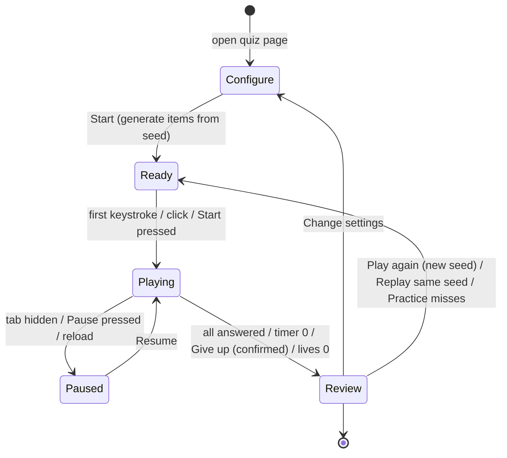

# Quiz Library

| Field | Value |
|---|---|
| Game ID | G-QZ |
| Slug / route | `/play/quiz` (library), `/play/quiz/<quiz-slug>` (a quiz) |
| Phase | **R1**: engine, formats `TYPE_ALL`, `TYPE_PROMPTED`, `MAP_CLICK`, `MULTIPLE_CHOICE`, families Countries, Capitals, Flags, Continents & Regions. R2: formats `TILE_SELECT`, `MATCH`, lives modifier, families Subdivisions, Subdivision capitals, Cities, Rankings. R3: physical features, historical countries. R4: landmarks. |
| Inspiration | JetPunk (Observed: secondary sources), Seterra (Observed: secondary sources). See [REFERENCE_RESEARCH §1](../REFERENCE_RESEARCH.md#1-jetpunk). |
| Depends on | `GameMap`, `AnswerInput`, `ChoiceGrid`, Name Matcher, Seeded RNG and Repeat Guard, Timer service ([ARCHITECTURE §5](../ARCHITECTURE.md#5-shared-game-infrastructure-vs-game-specific-logic)). Content packs `core.countries`, `geo.world.110m`, `geo.world.50m`, `flags` ([DATA_MODEL §2](../DATA_MODEL.md#2-content-pack-schemas)). |
| Governing ACs | AC-QZ-001 … AC-QZ-024 |

This spec also defines the **Name Matcher** (§5.1), which every game with typed answers uses.

## 1. Purpose and player experience

- **Learn and recall** the names, locations, capitals and flags of the world's places, then expand to subdivisions, cities, physical features and historical states.
- **Arc of a quiz:** quick early wins on familiar items, a mid-quiz grind, a final hunt for the last few, then a satisfying review that shows exactly what was missed and where.
- **Session length:** 1–15 minutes. Default quizzes are sized so that a timed run takes no more than 15 minutes.
- **Personas:** Completionist (timed, name-them-all), Learner (Learn mode, Practice my misses), Casual (Random 10, multiple choice).

## 2. Rules and complete gameplay loop

### 2.1 Concepts

| Concept | Definition |
|---|---|
| **Quiz template** | A family-level recipe: which entities are answers, what is prompted, and which formats are allowed. Example: `capitals.by-country`. |
| **Scope** | A filter on the entity set: `world`, a continent (`continent:AF`), a UN subregion (`region:western-asia`), or (R2) a custom list |
| **Format** | The interaction pattern: `TYPE_ALL`, `TYPE_PROMPTED`, `MAP_CLICK`, `MULTIPLE_CHOICE`, `TILE_SELECT` (R2), `MATCH` (R2) |
| **Quiz instance** | Template + scope + format + configuration + seed. This fully determines the items and their order. |
| **Item** | One answer slot (one entity) with its prompt |

A **quiz slug** is a human-readable alias for a popular template+scope+format combination, for example `countries-of-the-world` = `countries.by-name` + `world` + `TYPE_ALL`. Slugs are listed in §4.3.

### 2.2 Rules by format

**TYPE_ALL ("Name them all")**
1. The player sees the item count ("0 / 197"), a timer, a text input and (by default) a map or grid of unnamed slots.
2. Typed text is evaluated **on every keystroke** using the Name Matcher (§5.1). An exact match to a remaining item is accepted immediately and the input clears. The *prefix-hold* rule (§5.2) applies.
3. Pressing **Enter** also runs fuzzy matching. If there is still no match, the input shakes and shows a reason (§7.2). No penalty.
4. Items can be named in any order.
5. The quiz ends when all items are named, the timer expires, or the player presses **Give up** (confirmation required when more than 10% of the time remains).

**TYPE_PROMPTED ("Identify")**
1. One prompt at a time: a highlighted region on the map, a flag image, a capital name, or a country name (for a capitals quiz).
2. The player types and submits with Enter. Exact or fuzzy matching runs against the prompt's answer set.
3. A correct answer advances. On a wrong answer the item stays and the player may try again (unlimited tries; in Timed mode the clock keeps running) or press **Skip** (`Tab` or a button). Skipped items return to the end of the queue once. On their second appearance, Skip becomes **Reveal**.
4. The quiz ends when every item is answered or revealed, time expires, or the player gives up.

**MAP_CLICK ("Find it")**
1. One prompt at a time names an entity ("Click: Paraguay"). The map is unlabeled.
2. The player clicks or taps the map. Tiny-target expansion applies (§5.4).
3. A correct click fills the entity. A wrong click briefly labels the clicked entity ("That's Uruguay", 1.2 s) and costs one attempt.
4. **3 attempts per item.** After the 3rd miss, the correct entity pulses with a thick outline for 1.5 s, is marked *missed*, and the quiz advances.

**MULTIPLE_CHOICE**
1. One prompt with **4 options** (exactly 1 correct). Distractors are chosen as described in §6.3.
2. One attempt per item. Selecting an option locks it and shows correct and incorrect markers for 0.9 s (configurable to "wait for Next").
3. Keyboard: `1`–`4` select an option, and `Enter` advances when "wait for Next" is on.

**TILE_SELECT (R2)**: the player selects all tiles matching a criterion ("Select the landlocked countries", 24 tiles, 9 correct), then presses **Done** or names all correct tiles. Score = (correct selected − incorrect selected) / total correct, floored at 0.

**MATCH (R2)**: two columns (for example countries and capitals, 8 pairs). The player selects one item from each column to pair them. Wrong pairs flash and unpair.

**Lives modifier (R2):** `lives ∈ {∞, 1, 3}`. A wrong answer (a wrong MC option, a wrong MAP_CLICK attempt, or a wrong TILE_SELECT tile) costs a life. At 0 lives the quiz ends. "Sudden death" is `lives = 1`.

### 2.3 Session loop



## 3. Modes and configuration

| Mode | Description | Stats recorded | Phase |
|---|---|---|---|
| **Timed** | Countdown. Time limit from §6.2. | Yes, plus personal best | R1 |
| **Untimed** | Count-up clock, no limit | Yes, separate PB bucket | R1 |
| **Learn** | Map labels are shown on hover and focus, nothing is scored, and items reveal on request. For study. | Views only, which feed mastery as "seen" | R1 |
| **Practice my misses** | Items drawn from the player's weak entities in this template (§11.3) | Yes (practice bucket) | R1 |
| **Seeded challenge** | Opened from a link. Fixed items and order. | Yes, plus a comparison with the sender's score if it was embedded | R1 |
| **Daily quiz** | One seeded quiz per day, rotating through templates | Yes | R2 |

| Option | Values | Default | Notes |
|---|---|---|---|
| Format | Allowed by template (§4.2) | Template default | |
| Scope | world, continent, subregion, (R2) custom | world | Shows the item count live |
| Country set | `sovereign-197`, `un-193`, `sovereign-197+territories` | `sovereign-197` | See [DATA_AND_CONTENT §6](../DATA_AND_CONTENT.md#6-what-counts-as-a-country) |
| Item count | All, 10, 20, 50 (random subset) | All for TYPE_ALL, 20 otherwise | |
| Order | Random, Alphabetical, Largest first | Random | Not shown for TYPE_ALL |
| Timer | Timed, Untimed | Timed | |
| Difficulty | Easy, Normal, Hard | Normal | Affects subsets and distractors (§6.3) |
| Answer strictness | Lenient, Standard, Strict | Standard | §5.1 thresholds |
| Extra answer languages | none, es, fr, de, pt, it, nl (multi) | none | R2 |
| Show map (TYPE_ALL) | On, Off (grid only) | On | |
| Lives | ∞, 3, 1 | ∞ | R2 |

The configuration is remembered per template in local settings.

## 4. Data requirements

### 4.1 Fields used

From `core.countries` ([DATA_MODEL §2.2](../DATA_MODEL.md#22-entity-records)): `id`, `type`, `names` (with alias kinds), `continent`, `subregion`, `capitals[]`, `flag`, `area_km2`, `population`, `difficulty`, `sets[]` (membership in `sovereign-197`, `un-193`, `territories`), `ambiguity_groups`. From geometry packs: one feature per entity with `label_point` and `bbox`.

### 4.2 Templates

| Template | Answer entity | Prompt | Formats (phase) | Pool (world) |
|---|---|---|---|---|
| `countries.by-name` | country | none (TYPE_ALL) / highlighted shape | TYPE_ALL, TYPE_PROMPTED, MAP_CLICK (R1), TILE_SELECT (R2) | 197 (+ up to 50 territories) |
| `capitals.by-country` | capital name | country name | TYPE_PROMPTED, MC (R1), TYPE_ALL with map (R1), MATCH (R2) | 197 |
| `countries.by-capital` | country | capital name | TYPE_PROMPTED, MC (R1) | 197 |
| `flags.by-country` | country | flag image | TYPE_PROMPTED, MC, MAP_CLICK (R1), TILE_SELECT (R2) | 197 (+ territories with distinct flags) |
| `continents.by-name` | continent | highlighted region | MAP_CLICK, MC, TYPE_PROMPTED (R1) | 7 |
| `regions.by-name` | UN M49 subregion | highlighted region | MAP_CLICK, MC (R1) | 22 |
| `countries.by-continent` | continent | country name | MC (R1) | 197 |
| `subdivisions.by-name` | subdivision | none / highlighted | TYPE_ALL, MAP_CLICK, TYPE_PROMPTED, MC (R2) | 50 (US) to 47 (JP) per country |
| `subdivision-capitals.by-subdivision` | city | subdivision name | TYPE_PROMPTED, MC (R2) | per country |
| `cities.by-location` | city (point) | name | MAP_CLICK, TYPE_PROMPTED (R2) | 500 largest + capitals |
| `rank.by-stat` | country | statistic rank | TYPE_ALL (ranked list), handed to Rank It (R2) | top-N |
| `rivers.by-name`, `mountains.by-name`, `waters.by-name`, `islands.by-name`, `deserts.by-name` | physical feature | highlighted / name | MAP_CLICK, TYPE_PROMPTED (R3) | 50–150 each |
| `historical-states.by-name` | polity | highlighted on a dated basemap | TYPE_PROMPTED, MC (R3) | from Lost Borders data |
| `landmarks.by-location` | landmark | name / photo | MAP_CLICK, MC (R4) | 150 |

### 4.3 R1 named quizzes (library entries)

| Slug | Template | Scope | Format | Items | Time limit |
|---|---|---|---|---|---|
| `countries-of-the-world` | countries.by-name | world | TYPE_ALL | 197 | 13:00 |
| `countries-of-{continent}` (6: africa, asia, europe, north-america, south-america, oceania) | countries.by-name | continent | TYPE_ALL | 54 / 48* / 45* / 23 / 12 / 14 | per §6.2 |
| `find-countries-{scope}` (world + 6 continents) | countries.by-name | various | MAP_CLICK | 20 random (world) / all (continent) | per §6.2 |
| `capitals-of-{scope}` (world + 6) | capitals.by-country | various | TYPE_PROMPTED | all | per §6.2 |
| `capital-to-country-world` | countries.by-capital | world | MC | 20 | 3:20 |
| `flags-of-{scope}` (world + 6) | flags.by-country | various | TYPE_PROMPTED | all | per §6.2 |
| `flags-multiple-choice` | flags.by-country | world | MC | 20 | 3:20 |
| `continents-map` | continents.by-name | world | MAP_CLICK | 7 | 0:45 |
| `world-regions-map` | regions.by-name | world | MAP_CLICK | 22 | 2:15 |

\* Transcontinental countries are assigned to exactly one continent for quiz scoping: Russia → Europe, Turkey → Asia, Kazakhstan → Asia, Georgia/Armenia/Azerbaijan → Asia, Egypt → Africa, Cyprus → Asia (following UN M49). The Learn view shows a note on each. The final counts come from data. The numbers above are illustrative, and the AC tests read them from the pack.

### 4.4 Example records

```json
{
  "id": "country:CIV",
  "type": "country",
  "names": {
    "canonical": "Côte d'Ivoire",
    "aliases": [
      {"text": "Ivory Coast", "kind": "common"},
      {"text": "Cote d'Ivoire", "kind": "ascii"},
      {"text": "Republic of Côte d'Ivoire", "kind": "official"},
      {"text": "République de Côte d'Ivoire", "kind": "endonym", "lang": "fr"}
    ]
  },
  "continent": "continent:AF",
  "subregion": "region:western-africa",
  "capitals": [
    {"city": "city:gn-2279755", "name": "Yamoussoukro", "role": "official"},
    {"city": "city:gn-2293538", "name": "Abidjan", "role": "seat_of_government"}
  ],
  "sets": ["sovereign-197", "un-193"],
  "difficulty": {"recall": 0.46, "locate": 0.38, "flag": 0.55}
}
```

```json
{ "group": "congo", "alias": "Congo", "members": ["country:COG", "country:COD"],
  "message": "Which Congo? Try \"Republic of the Congo\" or \"DR Congo\"." }
```

## 5. Answer validation and interaction rules

### 5.1 Name Matcher (shared component)

**Normalization `norm(s)`**, applied identically to aliases at build time and to input at runtime:

1. Trim the input and cap it at 80 characters.
2. Unicode NFKD, then remove combining marks (diacritics): `Côte` → `Cote`, `São Tomé` → `Sao Tome`.
3. Fold special letters: `ß→ss`, `æ→ae`, `œ→oe`, `ø→o`, `ł→l`, `đ→d`, `ð→d`, `þ→th`, `ı→i`.
4. Lowercase (locale-independent).
5. Replace `&` with ` and `.
6. Replace every character that is not `[a-z0-9]` with a space, then collapse whitespace.
7. Token rewrites (whole tokens only): `st`→`saint`, `ste`→`sainte`, `mt`→`mount`, `ft`→`fort`, `is`→`island` **only when it is the last token**, `rep`→`republic`, `dem`→`democratic`.
8. Drop a leading `the`.
9. Remove all spaces. The result is the **key**: `"The Gambia"` → `gambia`, `"Guinea-Bissau"` → `guineabissau`, `"St. Lucia"` → `saintlucia`.

**Answer universe:** for each session, the matcher indexes every alias key of **every entity of the answer type** (for example all countries *and* territories), not just the items in this quiz. This makes "not in this quiz" and "already named" messages possible.

**Decision procedure for input key `k`:**

| Step | Condition | Result |
|---|---|---|
| 1 | `k` is empty | Ignore |
| 2 | `k` is exactly an alias key of one or more entities | Go to step 3. Fuzzy matching is never used when an exact match exists. |
| 3a | Exact match is in an **ambiguity group** and more than one member is a *remaining* item | **Reject: ambiguous.** Show the group message. No penalty. |
| 3b | Exact match is in an ambiguity group and exactly one member is a remaining item | Accept that member |
| 3c | Exact match to one entity, which is a remaining item (TYPE_ALL) or the prompt's answer (TYPE_PROMPTED) | **Accept** |
| 3d | Exact match to one entity already named | "Already named: *France*". No penalty. |
| 3e | Exact match to an entity outside the quiz (wrong scope or set) | "Not in this quiz: *Greenland* is an autonomous territory of Denmark." (Uses the entity's `not_in_set_reason` or a generated scope reason.) |
| 3f | Exact match to an entity that is the wrong answer (TYPE_PROMPTED) | Wrong. In Learn mode, show "That's *Niger*, not this one." |
| 4 | No exact match, and the input was **submitted** (Enter) | Run fuzzy matching (below) |
| 5 | No match | "Not recognized" |

**Fuzzy matching** (on submit only, never on keystroke): compute the Damerau–Levenshtein distance from `k` to every alias key in the universe. Let `t(len)` be the threshold for the alias key's length:

| Alias key length | Lenient | Standard | Strict |
|---|---|---|---|
| ≤ 4 | 0 | 0 | 0 |
| 5–7 | 1 | 1 | 0 |
| 8–12 | 3 | 2 | 0 |
| ≥ 13 | 4 | 3 | 0 |

Accept only if (a) the best candidate is within its threshold, (b) **no other entity** has an alias at the same or lower distance, and (c) the candidate is a remaining item or the prompt's answer. Otherwise reject with "Not recognized". Accepted fuzzy answers show "Accepted as *Kyrgyzstan*" and are listed in the review as "spelling corrected". They score the same as exact answers.

**Implementation clarifications (T0.8, normative):**
- The distance is optimal string alignment (insert, delete, substitute, adjacent transposition).
- Condition (b) compares each *entity's* best alias distance. Several aliases of one entity never tie with each other.
- Fuzzy matching ignores already-named and out-of-quiz entities as *targets*, but they still count as competitors for (b): if the nearest alias belongs to an already-named entity, the input is "Not recognized".
- An ambiguity group with no remaining member (all named, or none in the quiz) still shows the group message.
- An alias key shared by several entities without a declared group is treated as an implicit group: it resolves when exactly one of them remains, otherwise it is ambiguous. The content validator reports it as `ALIAS_COLLISION`.
- Prefix-hold considers every alias key of the other remaining items, so `uk` is held while Ukraine remains.
- In TYPE_PROMPTED, ambiguity groups resolve against the *remaining* items, not just the current prompt, so `congo` is rejected while both Congos are still to be asked.

**Never accepted:** prefixes ("Austr"), substrings, numeric codes (ISO codes like "FRA" are accepted only if listed as an alias kind `code`, which is enabled only for TYPE_ALL in Lenient mode).

### 5.2 Prefix-hold rule (TYPE_ALL keystroke acceptance)

If the exact key of a remaining item is also a **strict prefix** of an alias key of another *remaining* item (for example `niger` ⊂ `nigeria`, `dominica` ⊂ `dominicanrepublic`, `guinea` ⊂ `guineabissau`), acceptance is **held**:
- If the player keeps typing and the input becomes another exact match, accept that one instead.
- If 700 ms pass with no keystroke, or the player presses Enter, Space-then-Enter or Tab, accept the held item.
- If the player types a character that leaves both the held key and every longer key, the hold is cancelled and nothing is accepted.

Once the longer item has been named, the hold no longer applies (for example, after "Nigeria" is named, typing "Niger" accepts instantly).

### 5.3 Aliases and languages

- Every entity has a canonical English name plus aliases of kinds `common`, `official`, `ascii`, `former` (e.g. Swaziland, Burma), `endonym` (Latin script or romanized) and `code` (opt-in). Aliases in other languages (`lang` = es, fr, de, pt, it, nl) are active only when enabled (R2).
- `former` aliases are accepted. The review shows "Accepted (former name: Swaziland → Eswatini)".
- Non-Latin input (e.g. `日本`) is matched against `endonym` aliases that include native script when `lang` matches an enabled answer language. In R1 only Latin-script aliases are indexed, and non-Latin input shows "Try the English name".
- Alias data rules and collision validation are in [DATA_AND_CONTENT §5](../DATA_AND_CONTENT.md#5-names-aliases-and-languages).

### 5.4 Map interaction rules (MAP_CLICK and TYPE_PROMPTED with highlight)

- **Hit testing order:** (1) tiny-target circles, (2) polygons in the current geometry pack. The closest circle center within its radius wins.
- **Tiny-target expansion:** any entity whose on-screen bounding box is smaller than **14 px** (fine pointer) or **24 px** (coarse pointer, i.e. touch) on its longest side gets a hit circle. Its radius is 10 px (fine) or 16 px (coarse), centered on `label_point`, and drawn as a dashed ring so it is visible. The rings are recomputed on zoom.
- **Zoom and pan:** wheel or pinch zoom (1×–12×), drag to pan, double-tap or double-click to zoom ×2, plus `+`/`−`/`0` keys and on-screen buttons. A drag of more than 6 px is never treated as a click.
- **Touch confirmation:** on coarse pointers, when the tap point is within 8 px of a border between two candidates, or of two overlapping rings, a loupe callout shows a 3× magnified view and asks the player to tap again inside it.
- **Highlight prompts** (TYPE_PROMPTED): the target is drawn with a solid accent fill and a 2 px outline. If it is tiny, it also gets a pulsing ring, and the map auto-zooms so the target's bounding box fills at least 15% of the viewport.

### 5.5 Capitals

- An item's accepted answers are all `capitals[]` entries with role `official`, `constitutional` or `seat_of_government`. The review lists all of them with their roles, for example "Bolivia: Sucre (constitutional), La Paz (seat of government)".
- The capitals policy for contested cases is in [DATA_AND_CONTENT §7](../DATA_AND_CONTENT.md#7-contested-and-time-dependent-facts).
- In TYPE_ALL "capitals on a map", naming *any* accepted capital fills the country's slot.
- Duplicate capital names across the answer universe (e.g. "Victoria") are resolved by scope. A capital only matches items whose accepted list contains it.

## 6. Scoring and difficulty

### 6.1 Score

| Format | Item score | Quiz score |
|---|---|---|
| TYPE_ALL | 1 if named (0.5 if it was highlighted by a hint first), 0 if missed | `Σ / total` as a %, plus time used |
| TYPE_PROMPTED | 1 if correct without reveal, 0.5 if correct after using a hint, 0 if revealed | `Σ / total` |
| MAP_CLICK | 1 / 0.5 / 0.25 for the 1st / 2nd / 3rd attempt, 0 if missed | `Σ / total` |
| MULTIPLE_CHOICE | 1 or 0 | `Σ / total` |
| TILE_SELECT | — | `max(0, (TP − FP) / P)` |
| MATCH | 1 if paired without error, 0.5 otherwise | `Σ / pairs` |

**Personal best (PB)** is kept per *PB key* = `template | scope | format | countrySet | itemCount | timer`. A random-subset PB is only kept for `itemCount = all`. For subsets the profile shows a rolling average of the last 10 instead. A better score wins, and ties are broken by less time used.

Worked example: MAP_CLICK, 20 items, 15 first try, 3 second try, 1 third try, 1 missed → (15 + 1.5 + 0.25 + 0) / 20 = 83.75%, displayed as **84%** (round half up).

### 6.2 Time limits

`limit = ceil_to_15s(items × secondsPerItem)` with:

| Format | Seconds per item |
|---|---|
| TYPE_ALL | 4.0 |
| TYPE_PROMPTED | 9.0 |
| MAP_CLICK | 6.0 |
| MULTIPLE_CHOICE | 10.0 |
| TILE_SELECT | 3.0 per tile |
| MATCH | 8.0 per pair |

Example: countries of the world, TYPE_ALL, 197 × 4 = 788 s → **13:15**. (The §4.3 table shows 13:00 for readability. The formula is normative.)

### 6.3 Difficulty

Each entity has per-skill difficulty priors in [0, 1] (`recall`, `locate`, `flag`, `capital`), computed as in [DATA_AND_CONTENT §9](../DATA_AND_CONTENT.md#9-difficulty-priors). The quiz uses the skill that matches the template.

| Setting | Random subsets | MC distractors |
|---|---|---|
| Easy | Sample weighted toward difficulty < 0.4 (weight 3:1:0.3 for <0.4 / 0.4–0.7 / >0.7) | 3 random entities from **other continents** |
| Normal | Uniform | 2 from the same continent, 1 random |
| Hard | Weighted 0.3:1:3 | 3 from the same **subregion**, or from the entity's curated `confusables` list (e.g. flags Chad/Romania, Indonesia/Monaco, Ireland/Côte d'Ivoire). Confusables come first. |

Full-scope quizzes ("All") ignore subset weighting. Difficulty then affects only distractors and hint availability (Hard disables hints).

## 7. Hints and feedback

### 7.1 Hint ladder

| Format | Hint 1 | Hint 2 | Hint 3 | Cost |
|---|---|---|---|---|
| TYPE_ALL | Per-continent remaining counts (always visible, not a hint) | **Highlight one random unnamed item** on the map (`H`), up to 5 per quiz | — | A highlighted item scores 0.5 when named |
| TYPE_PROMPTED | First letter | Letter count with blanks (`_ _ _ _ _ _ _`) | Continent or subregion | Item scores 0.5 after any hint |
| MAP_CLICK | Zoom to the item's subregion | Show neighbors' outlines in bold | — | Max item score becomes 0.5 |
| MULTIPLE_CHOICE | 50/50: remove 2 wrong options (once per 10 items) | — | — | Item scores 0.5 |

Hints are disabled in Hard difficulty and in seeded challenges when the sender disabled them.

### 7.2 Feedback messages

| Event | Visual | Text | Screen reader (aria-live polite) |
|---|---|---|---|
| Accepted (TYPE_ALL) | Slot fills. Map region gets the "correct" fill **and** a ✓ marker. Counter ticks up. | — | "France. 88 of 197." |
| Accepted with fuzzy correction | As above, plus a small badge | "Accepted as Kyrgyzstan" | Same text |
| Already named | Input shakes 150 ms | "Already named: France" | Same |
| Ambiguous | Input outlined in the warning color | Group message | Same |
| Not in quiz | Info style | Reason text | Same |
| Not recognized (Enter) | Shake | "Not recognized" | Same |
| MAP_CLICK wrong | The clicked region shows its name in a tooltip and a ✕ marker for 1.2 s | "That's Uruguay. 2 tries left." | Same |
| Timer at 10% remaining | Timer turns to the warning style, with a ⏱ icon | — | "1 minute 19 seconds left" (once) |

Missed items in Review use a **hatched pattern fill plus a ✕ icon**, never color alone.

## 8. Screens and state transitions

### 8.1 Quiz library (`/play/quiz`)

```
┌──────────────────────────────────────────────────────────┐
│ Quiz Library                        [Search quizzes…   ] │
│ Category: [All][Countries][Capitals][Flags][Regions] …   │
│ Format:  [Any][Type][Map][Choice]   Length: [Any][<3m]…  │
├──────────────────────────────────────────────────────────┤
│ ★ Countries of the World     Type all · 197 · 13 min  PB 84% │
│   Countries of Africa        Type all · 54 · 3:45     —      │
│   Find the Country (World)   Map · 20 random · 2 min  71%    │
│   …                                                          │
│ [Build a custom quiz →]                                     │
└──────────────────────────────────────────────────────────┘
```

### 8.2 Configure (pre-game) panel

```
Countries of the World
Format: (•) Type all  ( ) Find on map  ( ) Identify  
Scope:  [World ▾]   Country set: [197 sovereign states ▾] ⓘ
Items:  [All (197) ▾]  Timer: (•) 13:15  ( ) Untimed
More options ▸ (difficulty, strictness, map on/off)
[ Start ]   [ Learn mode ]   Your best: 84% in 12:02
```

### 8.3 TYPE_ALL play (desktop ≥ 1024 px)

```
┌───────────────────────────────────────────────────────────────┐
│ ← Countries of the World      88 / 197      ⏱ 06:41   [Give up]│
├───────────────────────────────────────────────────────────────┤
│ [ Type a country…                                        ]    │
│ Accepted as Kyrgyzstan                                        │
├────────────────────────────────────────────┬──────────────────┤
│                                            │ Africa   21/54   │
│              WORLD MAP                     │ Asia     30/48   │
│   (named = filled + ✓, others outlined)    │ Europe   29/45   │
│                                            │ N. Amer.  5/23   │
│                                            │ S. Amer.  3/12   │
│                                            │ Oceania   0/14   │
│                                            │ [Highlight one H]│
└────────────────────────────────────────────┴──────────────────┘
```

On mobile (< 640 px), the input is pinned above the virtual keyboard, the map takes the remaining height, and continent counts collapse into a single "Africa 21/54 ▸" chip row that scrolls horizontally. `autocomplete`, `autocorrect`, `autocapitalize` and `spellcheck` are off on the input.

### 8.4 Review

```
Result: 171 / 197 (87%)  ·  12:02 used  ·  New personal best ▲3%
[Play again]  [Replay same]  [Practice my 26 misses]  [Share]
Map: missed = hatched + ✕     Filter: (All)(Missed)(Spelling corrected)
┌───────────────┬──────────────┬──────────────┐
│ Country       │ Your answer  │ Status       │
│ Kyrgyzstan    │ kyrgystan    │ ✓ spelling   │
│ Eswatini      │ swaziland    │ ✓ former name│
│ Tuvalu        │ —            │ ✕ missed     │ [Learn ▸]
└───────────────┴──────────────┴──────────────┘
```

"Learn ▸" opens an entity card (map, capital, flag, two facts, and a link to Atlas Explorer in R2).

### 8.5 State machine (engine)

| State | Events → next state |
|---|---|
| `configuring` | `START` → `ready` |
| `ready` | `INPUT` or `START_CLOCK` → `playing` |
| `playing` | `ANSWER`, `HINT`, `SKIP` → `playing`; `PAUSE`/`HIDDEN` → `paused`; `COMPLETE`/`TIMEOUT`/`GIVE_UP`/`LIVES_OUT` → `review` |
| `paused` | `RESUME` → `playing`; `GIVE_UP` → `review` |
| `review` | `PLAY_AGAIN`, `REPLAY_SEED`, `PRACTICE_MISSES` → `ready`; `CONFIGURE` → `configuring` |

## 9. Edge cases

| Case | Expected behavior |
|---|---|
| Player types "Ivory Coast" | Accepted as Côte d'Ivoire (alias kind `common`). No note in the review. |
| Player types "Swaziland" | Accepted as Eswatini. The review says "former name". |
| Player types "Holland" | Accepted as Netherlands (alias `common`). The Learn card explains that Holland is a region. |
| Player types "England" in a countries quiz | Not accepted: "England is part of the United Kingdom. Name the United Kingdom." No penalty. |
| Player types "Congo" while both Congos remain | Ambiguity message, nothing accepted |
| Player types "Congo" after "DR Congo" is named | Accepted as Republic of the Congo (§5.1 step 3b) |
| Player types "Korea" | Ambiguous (North Korea / South Korea) |
| Player types "Niger" while Nigeria remains | Held for 700 ms, then accepted as Niger, unless typing continues to "nigeria" |
| Player types "Greenland" in `sovereign-197` | "Not in this quiz: Greenland is an autonomous territory of Denmark." |
| Player types "Taiwan" with `un-193` set | "Not in this quiz: Taiwan is not a UN member state. Switch the country set to include it." |
| Player types "Micronesia" in countries | Accepted as Federated States of Micronesia. (In the regions universe, "Micronesia" means the subregion.) |
| Player clicks Tuvalu, which is 1 px wide at the current zoom | The dashed hit ring (16 px on touch) registers the click |
| A tap lands between Andorra's ring and the France polygon | Ring first: Andorra if inside its radius, otherwise France |
| Player refreshes during a timed quiz | On reload: "Resume *Countries of the World*? 88/197 named · 6:41 left" [Resume] [Discard]. The timer was paused from `pagehide`, so time is not lost. The result is marked `resumed: true`. See AC-QZ-012. |
| Player opens a second tab with the same quiz | Each tab has its own session ID. The newest active tab owns the "resume" slot, and the older tab shows "This quiz continued in another tab" when focused. |
| The device clock changes mid-quiz | The timer uses `performance.now()` deltas, not wall-clock time |
| Player replays a seeded challenge they already completed | They see their previous result first, with [Replay (practice)]. A replay is recorded with `attempt > 1` and does not replace the first-attempt comparison. |
| Content pack updated mid-quiz (new version deployed) | The session keeps its pack version, which is already loaded in memory. A reload restores using the stored `contentVersion`. If that version is no longer available, show "This quiz was updated. Restart?" |
| Template + scope gives fewer than 4 entities for MC | MC is disabled for that scope (e.g. continents MC uses 4 of 7, which is fine; a custom 3-item list cannot use MC) |
| Input of 500 pasted characters | Truncated to 80. No match. |
| Emoji or symbol input | Normalizes to an empty key, which is ignored |

## 10. Accessibility and mobile behavior

- **Keyboard:** the input is focused on start. `Enter` submits, `Tab` skips (TYPE_PROMPTED), `H` hint (when the input is empty or `Alt+H`), `Esc` pause, `1–4` MC options. All shortcuts are listed in a `?` dialog.
- **MAP_CLICK without a pointer:** a "Choose without the map" toggle is announced at quiz start for screen-reader users (`aria-describedby`). It converts the remaining items to **MULTIPLE_CHOICE using spatial descriptions**: "Which country is this? Landlocked, in South America, borders Brazil, Argentina and Bolivia." The descriptions are generated from adjacency and attribute data. The result is labeled "accessible variant" and kept in a separate PB bucket. Sighted keyboard users can instead use **spatial focus navigation**: arrow keys move a focus ring to the nearest entity in that direction, and `Enter` selects. The focused entity is **not** named aloud (that would reveal the answer). It is announced as "Region 37, in Africa".
- **Non-color feedback:** correct = solid fill + ✓, missed = hatched + ✕, highlighted target = accent fill + 2 px outline + pulsing ring. Patterns are SVG `<pattern>` definitions. They work in forced-colors mode with system colors.
- **Screen readers:** the TYPE_ALL counter and results are announced politely, and the review table is a real `<table>`.
- **Touch:** targets of at least 44×44 px for all buttons. Map tiny-target rings at 16 px radius (32 px diameter) plus the loupe.
- **Mobile layout:** at < 640 px, the map is above the input and fills the available height. The `visualViewport` API keeps the input visible above the keyboard.
- **Reduced motion:** shakes and pulses are replaced by a static outline change.

## 11. Unlimited-play and repeat-prevention behavior

1. **Instance generation:** `generateQuiz(template, scope, config, seed)` is pure and deterministic. It selects the item set (all or a weighted random subset), orders the items, and chooses distractors with a seeded PRNG ([ARCHITECTURE §8](../ARCHITECTURE.md#8-puzzle-generation-reproducibility-and-difficulty)).
2. **Repeat Guard for subsets:** for random subsets, items played in the player's last *K* instances of the same template+scope are down-weighted by ×0.2, where `K = floor(poolSize / itemCount) − 1` and at least 1. Example: Find the Country (World), 20 of 197: K = 8, so the last 8 rounds' items are unlikely. Full-scope quizzes have no repeat constraint, because the point is completeness.
3. **Practice my misses:** the item pool is entities with mastery `< 0.6` in this skill (missed in at least 1 of the last 3 exposures), ordered by spaced-repetition due date (§11.4). If fewer than 5 are available, the session is padded with the next-weakest items and the player is told "Only 3 weak spots. Adding 7 near-misses."
4. **Mastery model** (per entity per skill, stored locally): `mastery = 0.7 × mastery + 0.3 × itemScore` after each exposure, initialized at 0.5. Due date = `now + interval`, where interval doubles on a correct answer (1 d, 2 d, 4 d … up to 60 d) and resets to 10 min on a miss. The previous interval is derived from `due_at − last_seen_at` (a previous interval under 1 d counts as 0), so no extra stored field is needed.
5. **Seeds:** "Play again" uses a fresh random seed. "Replay same" reuses the seed. A challenge link encodes template, scope, config, seed and content version ([ARCHITECTURE §8.4](../ARCHITECTURE.md#84-challenge-codes)).
6. **Pool exhaustion:** not applicable for full quizzes. For subsets, the guard is a down-weighting, not an exclusion, so generation never fails.

## 12. Acceptance criteria

| ID | Given / When / Then | Example |
|---|---|---|
| AC-QZ-001 | Given a TYPE_ALL countries quiz, when the player types an exact alias of a remaining item, then it is accepted without Enter within one frame (< 16 ms of matcher time), and the input clears | Type `ivory coast` → Côte d'Ivoire slot filled, counter 1/197 |
| AC-QZ-002 | Normalization produces identical keys for diacritic, case, punctuation and article variants | `"Côte d’Ivoire"`, `"cote divoire"`, `"COTE D'IVOIRE"` → `cotedivoire`; `"The Gambia"` → `gambia` |
| AC-QZ-003 | Fuzzy matching accepts within threshold on Enter only, and never on keystroke | `kyrgystan` + Enter → accepted as Kyrgyzstan, badge shown; same text without Enter → not accepted |
| AC-QZ-004 | Fuzzy matching rejects when the nearest alias belongs to a different entity or there is a tie | Prompt = Niger, input `nigeria` → exact match to Nigeria → wrong (step 3f), never fuzzy-accepted as Niger |
| AC-QZ-005 | Prefix-hold | Remaining: Niger, Nigeria. Type `niger`, wait 700 ms → Niger accepted. Type `nigeria` quickly → Nigeria accepted, Niger remains. |
| AC-QZ-006 | Ambiguity group | Both Congos remaining, type `congo` → no acceptance, message contains "Which Congo?" |
| AC-QZ-007 | Ambiguity resolves when only one member remains | DR Congo already named, type `congo` → Republic of the Congo accepted |
| AC-QZ-008 | Out-of-set message | `sovereign-197`, type `greenland` → message "Not in this quiz" plus the reason, counter unchanged |
| AC-QZ-009 | Already named | Type `france` twice → second time "Already named: France", no score change |
| AC-QZ-010 | MAP_CLICK attempt scoring | Item Paraguay: click Uruguay, then Paraguay → item score 0.5, tooltip "That's Uruguay" shown on the first click |
| AC-QZ-011 | Tiny-target ring | At default world zoom on a 390×844 touch viewport, tapping within 16 px of Tuvalu's label point selects Tuvalu |
| AC-QZ-012 | Refresh resume | Timed quiz with 6:41 left and 88 named. Reload → resume dialog shows "88/197" and a time within ±1 s of 6:41. Resume → the same items are named and the timer continues. |
| AC-QZ-013 | Time limit formula | countries-of-the-world TYPE_ALL → limit 13:15 (from 197 × 4 = 788 s) |
| AC-QZ-014 | Give-up reveals missed answers with a non-color marker | Give up at 150/197 → 47 entities rendered with the hatched pattern and ✕. The review table lists 47 rows with status "missed". |
| AC-QZ-015 | Determinism | `generateQuiz(flags.by-country, world, {count:20, difficulty:normal}, seed "K7Q2M9XD1A")` returns the same 20 items in the same order and the same distractors on every run and device |
| AC-QZ-016 | Repeat Guard down-weighting | 1,000 simulated rounds of 20-of-197: the average overlap between consecutive rounds is ≤ 1.0 items (vs about 2.0 for uniform sampling) |
| AC-QZ-017 | Practice my misses | After missing Tuvalu, Nauru and Palau in Find the Country (Oceania), Practice my misses includes all 3 and is padded to ≥ 5 items with a notice |
| AC-QZ-018 | Multi-capital acceptance | Capitals quiz, prompt Bolivia: `la paz` accepted and `sucre` accepted. The review lists both with roles. |
| AC-QZ-019 | MC distractors on Hard use confusables | Hard flags MC for Chad → options include Romania |
| AC-QZ-020 | Accessible variant | With "Choose without the map" on, a MAP_CLICK item for Paraguay renders 4 options and a description containing "Landlocked" and "Brazil" |
| AC-QZ-021 | Former-name note | Typing `burma` → accepted as Myanmar, and the review row status reads "✓ former name" |
| AC-QZ-022 | Untimed PB bucket is separate | A 100% untimed run does not change the timed PB |
| AC-QZ-023 | Non-Latin input in R1 | Typing `日本` → "Try the English name", no acceptance |
| AC-QZ-024 | Keyboard-only completion | Playwright completes a 10-item MC flags quiz using only keys `1–4` and `Enter`, and reaches Review |
