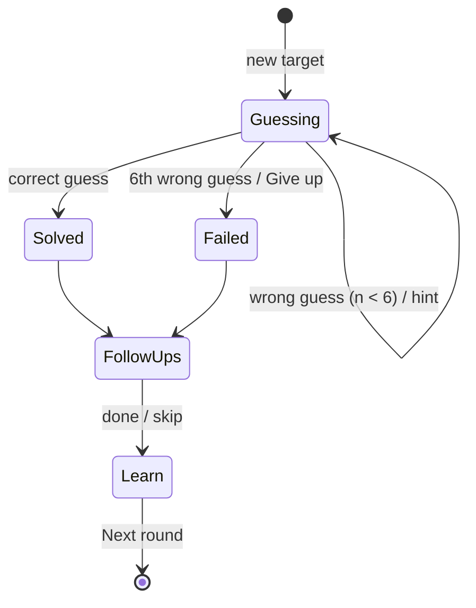

# Silhouette

| Field | Value |
|---|---|
| Game ID | G-SH |
| Slug / route | `/play/silhouette` |
| Phase | **R1** (Unlimited, Practice, Daily, Capital and Flag follow-ups). R2: Neighbors follow-up, proximity heat-map assist, regional pools for subdivisions (e.g. US states). |
| Inspiration | Worldle (Observed: [REFERENCE_RESEARCH §4](../REFERENCE_RESEARCH.md#4-worldle-worldleteuteuffr)). Distance-point rules, adjacency signal, remote-part handling, hint ladder and scoring are Proposed. |
| Depends on | Name Matcher ([quiz-library §5.1](quiz-library.md#51-name-matcher-shared-component)), `GameMap`, `SilhouetteRenderer`, `geo` package (distance, bearing), Repeat Guard. Packs `core.countries`, `geo.world.50m`, `geo.silhouettes`, `core.adjacency`. |
| Governing ACs | AC-SH-001 … AC-SH-020 |

## 1. Purpose and player experience

- Recognize countries by shape, and build a mental map of relative positions through distance and direction reasoning.
- **Arc:** puzzlement at the shape → a first "anchor" guess → triangulation with arrows → the "aha" → a learning card about the place.
- **Round length:** 30–120 s. **Session:** unlimited back-to-back rounds, with a running session score.
- **Personas:** Daily Puzzler, Completionist, Casual.

## 2. Rules and complete gameplay loop

1. A target entity is chosen from the **target pool** (§3). Its silhouette is shown: a filled shape, north-up, scaled to fit, with no scale bar, labels or surrounding context.
2. The player has **6 guesses**. A guess must resolve (Name Matcher, §5) to an entity in the **guessable universe**: all countries *and* territories in `core.countries`, which is always a superset of the target pool.
3. Invalid input ("Not a recognized country or territory") and repeated guesses ("Already guessed") **do not consume** a guess.
4. For each valid wrong guess, the game shows **distance**, **direction**, **proximity %** and a **shared-border marker** (§5.3).
5. A correct guess wins the round. After the 6th wrong guess the round is lost and the answer is revealed.
6. After either outcome, **follow-up rounds** are offered (§3). They are optional and each takes one prompt.
7. The **Learn card** (§8.4) is always shown at the end of the round.
8. **Next round** generates a new target immediately (Unlimited) or returns to the daily summary (Daily).



## 3. Modes and configuration

| Mode | Description | Phase |
|---|---|---|
| **Unlimited** (default) | Endless rounds. Running session score and solve rate. | R1 |
| **Practice** | No score, unlimited guesses, all hints free, guesses shown on a live map | R1 |
| **Daily** | One target per local calendar day, the same for everyone, with a share card | R1 |
| **Seeded challenge** | A link reproduces a set of 5 or 10 targets | R1 |
| **Regional pools** | US states, Canadian provinces, etc. (uses subdivision packs) | R2 |

| Option | Values | Default | Effect |
|---|---|---|---|
| Target pool | Sovereign 197, UN 193, Sovereign + territories, a single continent | Sovereign 197 | Which entities can be targets |
| Difficulty | Easy, Normal, Hard | Normal | See §6.2 |
| Distance unit | km, mi | from locale (mi for en-US, otherwise km) | |
| Show guesses on map | On, Off | On (Easy/Normal), Off (Hard) | A mini world map shades guessed entities by proximity |
| Follow-ups | Capital, Flag, (R2) Neighbors (multi-select) | Capital + Flag | |

## 4. Data requirements

| Field | Source | Use |
|---|---|---|
| `geo.silhouettes[id].parts` | Derived from Natural Earth 1:10m `admin_0_map_units` (with overrides) | The drawn shape |
| `geo.silhouettes[id].remote_parts` | Same | Hint "Reveal remote parts" |
| `ref_point` (lat, lon) | Computed: pole of inaccessibility of the largest polygon (§5.3) | Distance and direction |
| `core.adjacency` | Derived from land-boundary intersection of 1:10m geometry, with editorial overrides | Shared-border marker, Neighbors follow-up |
| `area_km2`, `continent`, `capitals`, `flag`, `population` | `core.countries` | Hints and the Learn card |
| `difficulty.shape` | Prior ([DATA_AND_CONTENT §9](../DATA_AND_CONTENT.md#9-difficulty-priors)) | Easy pool filter |

**Pool size:** 197 targets by default, 240+ with territories. That gives at least 98 rounds before the Repeat Guard window cycles (§11), and more than 200 distinct rounds overall.

Example silhouette record:

```json
{
  "id": "country:FRA",
  "ref_point": [46.6, 2.5],
  "parts": "<TopoJSON object ref: metropolitan France + Corsica>",
  "remote_parts": ["French Guiana", "Guadeloupe", "Martinique", "Mayotte", "Réunion"],
  "silhouette_rule": "auto",
  "projection": {"type": "azimuthalEqualArea", "rotate": [-2.5, -46.6]}
}
```

## 5. Answer validation and interaction rules

### 5.1 Guess input

- An `AnswerInput` with an **autocomplete listbox**. After 1 character, it shows up to 6 suggestions whose alias keys *start with* the normalized input, ranked by canonical-name match first, then alphabetically. Selecting a suggestion submits that entity.
- Free text + Enter uses the Name Matcher (exact, then fuzzy). Ambiguity groups (e.g. "Congo") show the group message and consume nothing.
- Suggestions include all guessable entities. They are never filtered to the target pool, because filtering would leak information.

### 5.2 What a guess resolves to

The guess resolves to an entity ID. Territories are distinct entities: "Greenland" is `territory:GRL`, not Denmark. If the target pool excludes territories, a territory guess is still valid and receives feedback like any other guess.

### 5.3 Distance, direction, proximity: normative definitions

**Reference point.** Each entity's `ref_point` is the **pole of inaccessibility** (the point farthest from the boundary, computed with `polylabel` at a precision of min(0.01°, one hundredth of the polygon's smaller side) in an equirectangular frame scaled by cos(latitude). A fixed 0.01° is wider than the Vatican itself, which put its point outside its borders) of its **largest polygon by geodesic area**, using 1:10m geometry. Rationale:
- It always lies **inside** the entity's main landmass. Centroids can fall outside (Chile, Indonesia, Croatia) or in the sea between islands.
- Using the largest polygon keeps France on metropolitan France rather than drifting toward the overseas regions, and keeps the US in the contiguous states.
- It is stable and reproducible, and it is precomputed at build time and stored in the pack.

Editorial overrides of `ref_point` are allowed only with a recorded reason (e.g. a disputed main polygon) and are listed in `content/overrides/ref_points.yaml`.

**Distance** `d` is the great-circle (haversine) distance between the guess and target `ref_point`s, with the mean Earth radius R = 6371.0088 km. It is displayed rounded to the nearest whole km (or mile, at 1 mi = 1.609344 km). A correct guess shows "0 km".

**Direction** is the **rhumb-line (constant-bearing) bearing** from the guess ref point to the target ref point, taking the shorter way around in longitude (crossing the antimeridian when that is shorter). It is bucketed into 8 sectors of 45°: N = [337.5°, 22.5°), NE = [22.5°, 67.5°), E, SE, S, SW, W, NW. A rhumb line never routes over a pole and matches how players read a flat map. The exact bearing (integer degrees) is exposed to screen readers and in the Learn card.

**Proximity** `p = floor(100 × (1 − d / 20015.1))`, where 20,015.1 km is half the Earth's circumference. A correct guess shows 100%. A wrong guess is capped at 99%.

**Shared-border marker:** if the guess and the target share a land border in `core.adjacency`, the row shows a "⇆ Shares a border" badge. This prevents the confusing case where a neighbor's ref point is far away (e.g. Russia → Kazakhstan).

Worked examples (fixture ref points):

| Guess (ref) | Target (ref) | Distance | Bearing → sector | Proximity |
|---|---|---|---|---|
| France (46.6, 2.5) | Spain (40.2, −3.6) | 865 km | 214.7° → **SW** | 95% |
| Brazil (−14.0, −52.0) | France (46.6, 2.5) | 8,651 km | 39.2° → **NE** | 56% |
| Fiji (−17.8, 178.0) | Samoa (−13.8, −172.1) | 1,148 km | 67.2° → **NE** (crosses the antimeridian eastward) | 94% |
| Antipodal fixture (0, 0) | (0, 180) | 20,015 km | 90.0° → **E** | 0% |

### 5.4 Silhouette geometry rules (islands, overseas territories, multipart shapes)

1. **Main group:** the largest polygon plus every other polygon whose ref point is within **1,500 km** of the largest polygon's ref point. This keeps Corsica with France and Sicily and Sardinia with Italy.
2. **Remote parts:** polygons outside the main group. They are **not drawn** in the silhouette, are listed in `remote_parts`, and can be revealed with a hint as small labeled insets.
3. **Archipelagic entities** (largest polygon < 50% of total area, e.g. Indonesia, Philippines, Fiji, Kiribati, Maldives): the main group radius is extended to **3,000 km**. Kiribati remains a deliberately hard case and shows the Gilbert Islands group. An editorial override may choose the group.
4. **Overrides** (`content/overrides/silhouettes.yaml`) record any exception with a reason. Initial overrides: United States = contiguous 48 states (Alaska and Hawaii become remote parts), Norway excludes Svalbard and Jan Mayen, Denmark excludes Greenland and the Faroe Islands (separate territory entities), Ecuador excludes the Galápagos, Chile excludes Easter Island.
5. **Projection:** Lambert azimuthal equal-area, centered on the main group's bounding-circle center, north-up. This avoids Mercator size distortion for high-latitude shapes.
6. **Fit:** scaled to fit a square viewbox with 8% padding. Entities with only tiny parts (Nauru, Tuvalu, Monaco) are drawn at the same fitted size, so absolute size is not a clue. Size is available as a hint.
7. **Antimeridian:** parts spanning ±180° (Fiji, Russia's Chukotka, Kiribati) are unwrapped by the projection's rotation, so no shape is split.

## 6. Scoring and difficulty

### 6.1 Round score (Unlimited)

- Solved in *n* guesses: `points = 7 − n − hintsUsed`, minimum **1**. (Solved first try with no hints = 6.)
- Failed: 0.
- Each correct follow-up: +1.
- **Session summary:** total points, rounds, solve rate, average guesses on solved rounds.
- **Daily** shares guesses (`3/6`) and follow-up stars.

Example: solved in 3 guesses with 1 hint, plus the capital correct and the flag wrong → 7 − 3 − 1 = 3, + 1 = **4 points**.

### 6.2 Difficulty

| Setting | Target pool | Silhouette | Hints |
|---|---|---|---|
| Easy | Entities with `difficulty.shape < 0.45` (about the 90 most recognizable) | North-up | Continent revealed at start for free |
| Normal | Configured pool | North-up | Ladder (§7) |
| Hard | Configured pool, with small entities (< 5,000 km²) weighted ×2 | **Randomly rotated** 0–359° (seeded). No north indicator. | Ladder costs ×2 |

## 7. Hints and feedback

### 7.1 Hint ladder (each costs 1 point; available from the start)

| # | Hint | Content example |
|---|---|---|
| 1 | Size | "Area 640,679 km². Larger than 88% of countries." |
| 2 | Continent | "Europe" |
| 3 | Remote parts (only if any exist) / otherwise number of land neighbors | Insets labeled "French Guiana (South America)" … / "8 land neighbors" |
| 4 | First letter | "F" |

### 7.2 Guess row feedback

```
┌──────────────┬──────────┬─────┬──────────────────────┐
│ Brazil ⇆     │ 8,651 km │ ↗ NE│ ▰▰▰▰▰▱▱▱▱▱ 56%        │
│ Spain  ⇆     │   865 km │ ↗ NE│ ▰▰▰▰▰▰▰▰▰▱ 95%        │
│ France  ✓    │     0 km │ ✓   │ ▰▰▰▰▰▰▰▰▰▰ 100%       │
└──────────────┴──────────┴─────┴──────────────────────┘
```

- Direction is shown as an arrow glyph **and** a text abbreviation. The proximity bar has 10 segments (one per 10%, floor) **and** a number.
- Screen reader announcement after each guess: "Guess 2 of 6: Spain. 865 kilometres, north-east, 95 percent. Shares a border."

## 8. Screens and state transitions

### 8.1 Play (mobile, 390 px)

```
┌──────────────────────────────┐
│ ← Silhouette   Round 7  ★ 23 │
│ ┌──────────────────────────┐ │
│ │                          │ │
│ │       [ SHAPE ]          │ │
│ │                          │ │
│ └──────────────────────────┘ │
│ [Hint ▾ 4 left]    Guess 3/6 │
│ Brazil ⇆ 8,651 km ↗NE 56%    │
│ Spain ⇆   865 km ↗NE  95%    │
│ ┌──────────────────────────┐ │
│ │ Country or territory…    │ │
│ └──────────────────────────┘ │
│  ▸ France                    │
│  ▸ French Polynesia          │
└──────────────────────────────┘
```

On desktop (≥ 1024 px) the shape is on the left (≥ 420 px) and the guess list and mini-map are on the right.

### 8.2 Follow-up: Capital (R1)

"What is the capital of France?": 4-option MC (distractors: 3 capitals from the same continent), 1 attempt. Flag: 4 flag images, 1 attempt, Normal-difficulty distractors from [quiz-library §6.3](quiz-library.md#63-difficulty). Neighbors (R2): a select-all on the map of the target's region; scored only if every neighbor is selected and nothing else.

### 8.3 Daily summary

Shows the result, a share button, a countdown to the next daily, and **[Keep playing: Unlimited]** as the primary button. Daily is never a dead end.

### 8.4 Learn card

A map with the target's full geometry (including remote parts, labeled), ref points of each guess and the target shown as dots with great-circle lines, capital, population, area, neighbors, official languages, two facts from the fact bank, and the note "Distances are measured between the points shown (the center of each country's largest landmass)."

## 9. Edge cases

| Case | Expected behavior |
|---|---|
| Target Russia, guess Kazakhstan | Distance is large between ref points, but the ⇆ marker shows they share a border |
| Guess a territory while the pool is sovereign-only | Valid. Feedback is shown. |
| Guess "Congo" | Ambiguity message. No guess consumed. |
| Guess with typo "Phillipines" + Enter | Fuzzy-accepted as Philippines, with the "Accepted as" note |
| Target is Vatican City; guess is Italy | A short distance from Italy's ref point (on the mainland), plus the ⇆ marker (Vatican borders Italy) |
| Target France; guess Brazil | Distance is measured to metropolitan France's ref point (8,651 km), **and** the ⇆ marker shows, because French Guiana is an integral part of France and borders Brazil. The Learn card explains this. |
| Target Kiribati (archipelagic, spans the antimeridian) | Gilbert group drawn without a split. Hint 3 reveals the Phoenix and Line Islands. |
| Player refreshes mid-round | The round restores with the same target and guesses (state is saved after every guess) |
| Player reopens a completed daily | Shows the completed summary. "Play again" is unavailable for that daily but "Practice this shape" opens it in Practice (unscored). |
| Two devices for the daily (guest) | Independent. With an account (R2), the first completed result syncs and the other device shows it. |
| Player opens a seeded link containing a target they solved before | Plays normally. The history note "You've seen this one before" appears after the round, never before. |
| Guess exactly at the 22.5° boundary | The sector's lower bound is inclusive: 22.5° → NE |
| Identical ref points (impossible, but guarded) | Bearing undefined → show "•" with the text "same point" |

## 10. Accessibility and mobile behavior

- The game is inherently visual (shape recognition). For screen-reader users, the silhouette has an `aria-label` with a **non-revealing description** generated from shape metrics: "Shape: compact, roughly as wide as it is tall, coastline on the west and south, 2 remote parts." Practice mode is recommended through a visible "Play with descriptions" toggle, which adds the description as text. This is labeled "assisted" in stats.
- All feedback is text plus glyphs. No color-only signals.
- The autocomplete listbox follows the WAI-ARIA combobox pattern: arrow keys, Enter, Esc.
- Touch: the input sits above the keyboard, and suggestions render *above* the input on mobile so they are not covered.
- Reduced motion: no flip animations on reveal.

## 11. Unlimited-play and repeat-prevention behavior

- **Target selection (Unlimited):** draw from the pool with the Repeat Guard:
  - Exclude targets from the player's last `W = min(100, floor(poolSize × 0.5))` Silhouette rounds (98 for the default pool).
  - Exclude entities under 5,000 km² from the last 7 rounds as an extra rule (these are the most memorable when repeated).
  - Down-weight ×0.3 any entity on the same continent as the previous round.
  - If the eligible set is empty (e.g. a single-continent pool), halve `W` repeatedly until it is non-empty.
- **History** is stored locally (and synced in R2) as a ring buffer of target IDs per game and pool.
- **Daily:** `content/daily/silhouette.json` maps each date to a target for 730 days. It is generated by a build script with rules: no repeat within 150 days, no consecutive same continent, small entities at most once per 7 days, and difficulty smoothed (rolling 7-day mean within ±0.1). Daily uses the player's **local date**. The share card includes the date so players in different time zones can compare.
- **Seeded challenge:** `seed → [targets]` with the same Repeat Guard rules applied *within* the challenge only (no history), so a link is identical for everyone.
- **Replaying:** a daily or seeded challenge already completed can be replayed only in Practice, and results are not recorded as first attempts.

## 12. Acceptance criteria

| ID | Given / When / Then | Example |
|---|---|---|
| AC-SH-001 | Distance uses haversine between ref points, rounded to the nearest km | (46.6, 2.5)→(40.2, −3.6) = **865 km** |
| AC-SH-002 | Direction is rhumb-line bucketed to 8 sectors | Same pair → 214.7° → **SW** |
| AC-SH-003 | Antimeridian handled | (−17.8, 178.0)→(−13.8, −172.1) → 1,148 km, **NE**, 94% |
| AC-SH-004 | Proximity formula | 8,651 km → **56%**; antipodal → 0%; correct → 100% |
| AC-SH-005 | Shared-border marker | Target Russia, guess Kazakhstan → row shows "⇆" and the text "Shares a border" |
| AC-SH-006 | Invalid and duplicate guesses do not consume attempts | Input "Narnia" → "Not recognized", counter stays 1/6. "Spain" twice → "Already guessed". |
| AC-SH-007 | Territories are guessable in a sovereign pool | Guess "Greenland" → valid row with distance |
| AC-SH-008 | Ambiguous guess | "Congo" → group message, counter unchanged |
| AC-SH-009 | Remote parts excluded from the silhouette | France silhouette contains 2 polygons (mainland, Corsica). Hint 3 lists 5 remote parts. |
| AC-SH-010 | US override | The USA silhouette excludes Alaska and Hawaii, which appear in `remote_parts` |
| AC-SH-011 | Scoring | Solved in 3 guesses with 1 hint and 1 follow-up correct → 4 points |
| AC-SH-012 | Repeat Guard | 98 consecutive Unlimited rounds on the default pool → 98 distinct targets |
| AC-SH-013 | Small-entity rule | In 1,000 simulated rounds, no entity < 5,000 km² appears twice within any 7-round window |
| AC-SH-014 | Daily determinism | On 2026-11-05 every client loads the same target from the schedule. Reopening after completion shows the summary. |
| AC-SH-015 | Daily schedule validation | The CI validator confirms no target repeats within 150 days across the 730-day schedule |
| AC-SH-016 | Refresh mid-round | After 2 guesses and a reload, the same target and 2 rows are present, with 4 guesses left |
| AC-SH-017 | Hard rotation determinism | The same seed yields the same rotation angle on every run |
| AC-SH-018 | Screen reader announcement after a guess | Contains the guess name, distance, direction word, percent and border status |
| AC-SH-019 | Daily → Unlimited path | The daily summary's primary button starts an Unlimited round in ≤ 300 ms (pack cached) |
| AC-SH-020 | Suggestions do not leak the pool | With a sovereign pool, typing "gre" suggests Greece, Greenland and Grenada |
